# uNPU RTL — architecture guide

A 4×4 INT8 **weight-stationary systolic array** that computes `C = A × B` for matrices up to 4×4, built as a hard macro for the Frankenstein 180 nm IP-validation SoC (EE5239, Project 2). This folder holds the synthesisable SystemVerilog: 11 modules, 1 756 lines.

> A longer, from-first-principles version of this guide, with the same figures, is in **[`uNPU_architecture_from_scratch.pdf`](uNPU_architecture_from_scratch.pdf)**.

| | |
|---|---|
| Operation | `C[M×N] = A[M×K] · B[K×N]`, with `1 ≤ M, N, K ≤ 4` per job |
| Operands / results | INT8 in (signed or unsigned), INT32 out |
| Array | 16 processing elements, one MAC each per cycle (peak 16 MAC/cycle = 1.6 GOPS at 50 MHz) |
| Clock | 50 MHz target, single clock domain, async active-low reset |
| Control port | **APB slave**, zero wait states, 8 registers in `0x4000_0000 – 0x4000_0FFF` |
| Data port | **Native valid/ready master** to the SRAM arbiter; the NPU fetches A, B and writes C itself |
| Latency | `26 + 2K + 3M + 2MN` cycles from start to DONE → **78 cycles** for a full 4×4×4 job |

---

## Contents

1. [Where it sits in the SoC](#1-where-it-sits-in-the-soc)
2. [Block diagram and file map](#2-block-diagram-and-file-map)
3. [The idea: weight-stationary systolic matrix multiply](#3-the-idea-weight-stationary-systolic-matrix-multiply)
4. [Module by module](#4-module-by-module)
5. [Protocols](#5-protocols)
6. [Memory layout](#6-memory-layout)
7. [Timing and performance](#7-timing-and-performance)
8. [Programming it from firmware](#8-programming-it-from-firmware)
9. [Worked example](#9-worked-example)
10. [Design rules and known traps](#10-design-rules-and-known-traps)
11. [Limits and open items](#11-limits-and-open-items)

---

## 1. Where it sits in the SoC

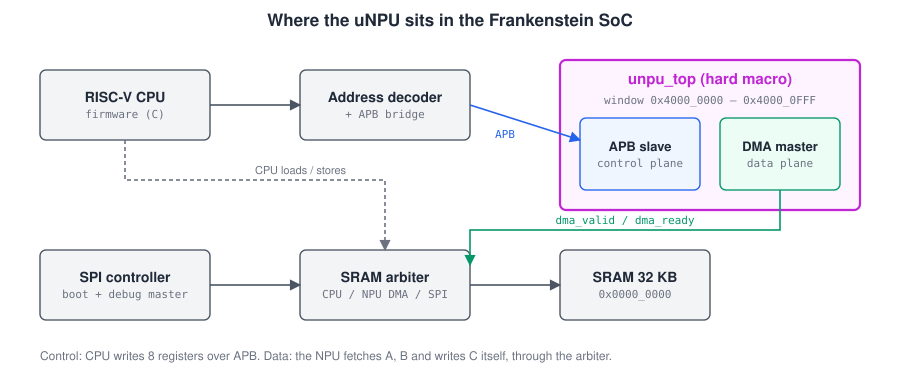

The macro has two ports, and they do different jobs:

- **Control plane (APB slave).** The CPU (or the SPI debug master, when the CPU is down) writes pointers, dimensions and START, then polls a status register. These are a few register accesses per job.
- **Data plane (native master).** The NPU itself reads A and B from SRAM and writes C back, through the same arbiter the CPU uses. The CPU never copies operands into the NPU.

---

## 2. Block diagram and file map

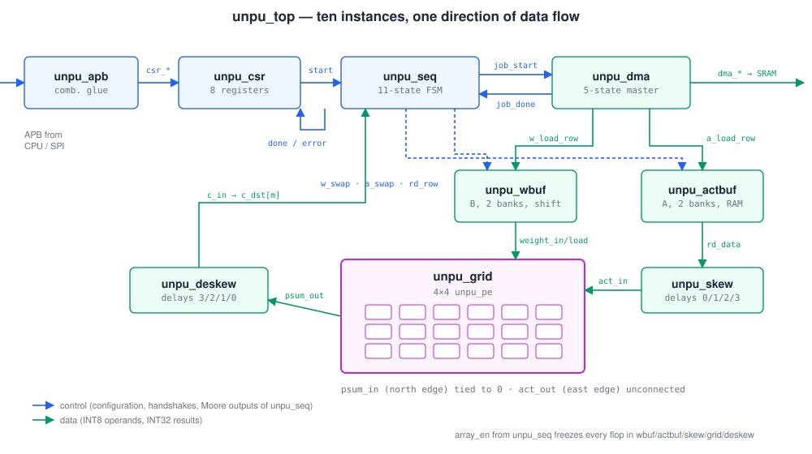

`unpu_top` is pure wiring: ten instances, no logic of its own except two tie-offs. Data flows one way. SRAM → `unpu_dma` → buffers → skew → grid → de-skew → captured by `unpu_seq` → back out through `unpu_dma`.

| File | Lines | Role | Kind |
|---|---:|---|---|
| [`unpu_pe.sv`](unpu_pe.sv) | 48 | One multiply-accumulate cell, weight held in a register | datapath |
| [`unpu_grid.sv`](unpu_grid.sv) | 70 | 4×4 array of PEs (`generate`) | datapath |
| [`unpu_skew.sv`](unpu_skew.sv) | 73 | Input delays 0/1/2/3 per row | datapath |
| [`unpu_deskew.sv`](unpu_deskew.sv) | 71 | Output delays 3/2/1/0 per column | datapath |
| [`unpu_wbuf.sv`](unpu_wbuf.sv) | 218 | Weight (B) buffer, two banks, shift-in, parallel load into PEs | buffer |
| [`unpu_actbuf.sv`](unpu_actbuf.sv) | 155 | Activation (A) buffer, two banks, row-addressed read | buffer |
| [`unpu_dma.sv`](unpu_dma.sv) | 234 | Bus master: fetch A, fetch B, write C | control + data |
| [`unpu_seq.sv`](unpu_seq.sv) | 338 | Main 11-state sequencer | control |
| [`unpu_csr.sv`](unpu_csr.sv) | 170 | 8 configuration/status registers | control |
| [`unpu_apb.sv`](unpu_apb.sv) | 93 | APB → register-port glue (no flops) | control |
| [`unpu_top.sv`](unpu_top.sv) | 286 | Instantiates and connects all of the above | top |

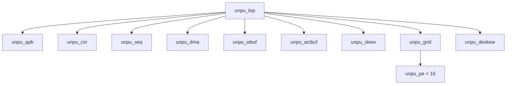

---

## 3. The idea: weight-stationary systolic matrix multiply

Every output element is a dot product:

```
C[m][j] = Σ_k  A[m][k] · B[k][j]          (k = 0 … K-1)
```

A systolic array computes these dot products by passing data between neighbouring cells, one hop per clock, so no cell ever needs a long wire or a shared bus.

**Weight-stationary** means each PE loads one weight and keeps it for the whole job: **PE(k, j) holds `B[k][j]`**. Activations then flow **east** along each row and partial sums flow **south** down each column:

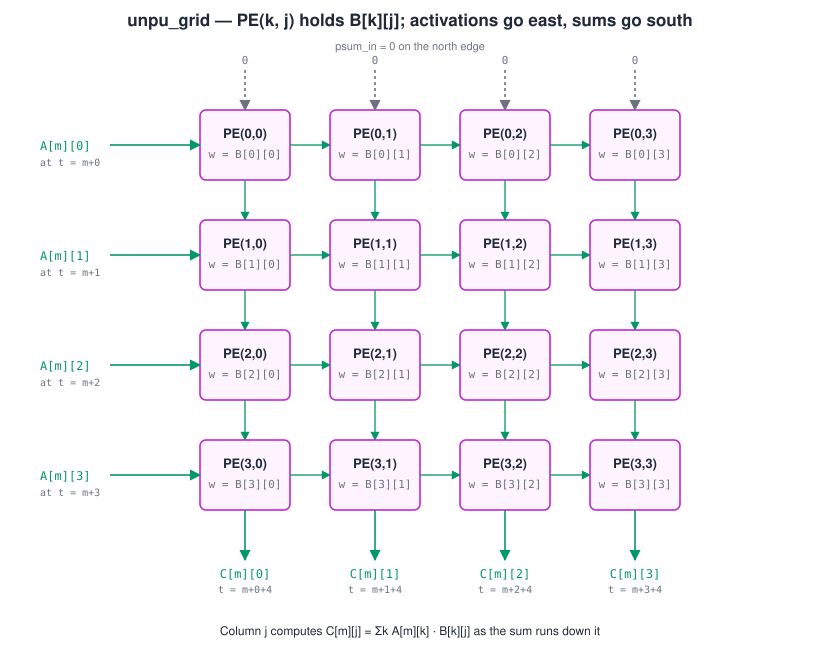

Follow column `j`. Row 0 computes `A[m][0]·B[0][j]` and passes it down. Row 1 adds `A[m][1]·B[1][j]`, and so on. After row 3 the column has produced the full `C[m][j]`. All four columns do this in parallel, each with its own weights. A new row `m` of A can enter every cycle.

The catch: a partial sum reaches row `k` exactly `k` cycles after it left row 0. So `A[m][k]` has to arrive at row `k` **k cycles late** as well. That is what the skew bank is for, and the de-skew bank undoes the matching stagger on the way out (section 4.3).

---

## 4. Module by module

Bottom-up, in the order the design was built and tested.

### 4.1 `unpu_pe` — the processing element

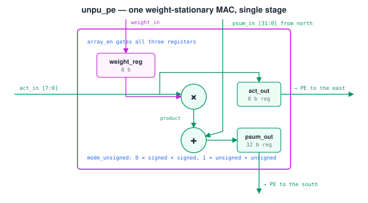

One combinational 8×8 multiply and one 32-bit add, with three registers. Nothing is pipelined: at 50 MHz the multiply + add path (~7 ns at 180 nm) fits easily in the 20 ns period.

```systemverilog
always_comb begin
  if (mode_unsigned)
    product = $unsigned(weight_reg) * $unsigned(act_in);
  else
    product = 32'($signed(weight_reg) * $signed(act_in));
end

always_ff @(posedge clk or negedge rst_n) begin
  if (!rst_n) begin ... end
  else if (array_en) begin            // global freeze
    if (weight_load) weight_reg <= weight_in;
    act_out  <= act_in;               // pass activation east
    psum_out <= psum_in + product;    // pass running sum south
  end
end
```

Points worth knowing:
- `psum_out` is **not** a self-accumulator. It is `psum_in + product`, a pure function of this cycle's inputs. Garbage that flows through during idle cycles is overwritten, never remembered (this is why one `array_en` can stay high for the whole job).
- `weight_load` and the product use the **old** `weight_reg`, so loading a weight never corrupts the same cycle's product.
- When `array_en = 0` every register holds, including `weight_reg`.

### 4.2 `unpu_grid` — the 4×4 array

Two nested `generate` loops pick each PE's neighbours: column 0 takes the west-edge input, row 0 takes the north-edge input, and everyone else takes the registered output of the PE to the west or north.

```systemverilog
for (row = 0; row < 4; row++) begin : g_row
  for (col = 0; col < 4; col++) begin : g_col
    if (col == 0) assign pe_act_in  = act_in[row];               // west edge
    else          assign pe_act_in  = act_link[row][col-1];
    if (row == 0) assign pe_psum_in = psum_in[col];              // north edge
    else          assign pe_psum_in = psum_link[row-1][col];
    unpu_pe pe ( ... .act_out(act_link[row][col]), .psum_out(psum_link[row][col]) );
  end
end
assign psum_out[col] = psum_link[3][col];                       // south edge
```

In `unpu_top` the north edge (`psum_in`) is tied to 0 and the east edge (`act_out`) is left unconnected, so synthesis removes the last column's activation registers.

### 4.3 `unpu_skew` and `unpu_deskew` — lining up the wavefront

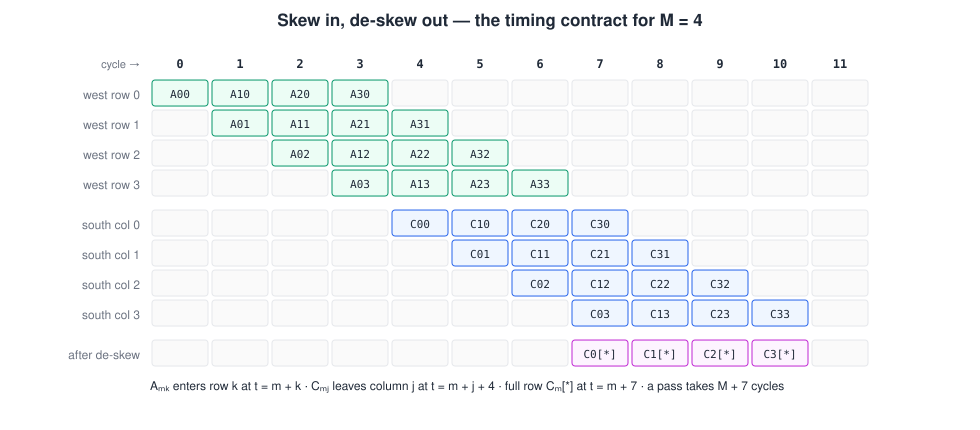

The **timing contract** every module agrees on:

```
A[m][k] enters west edge of row k      at cycle  m + k
A[m][k] reaches PE(k, j)               at cycle  m + k + j
C[m][j] leaves south edge of column j  at cycle  m + j + 4
whole row C[m][*] valid after de-skew  at cycle  m + 7
one pass of M rows takes                         M + 7 cycles
```

The buffer presents a whole row `A[m][0..3]` at once on cycle `m`. `unpu_skew` delays row `k` by `k` flops. `unpu_deskew` delays column `j` by `3 − j` flops, so all four columns of `C[m]` land together. Both are written out by hand (no variable-depth `generate`) so the depth-0 lane is clearly a wire:

```systemverilog
// unpu_skew: row 0 is a wire, row 3 is three flops
assign act_out[0] = a_raw[0];
always_ff @(posedge clk or negedge rst_n)
  if (!rst_n) ... else if (array_en) begin
    row3_q1 <= a_raw[3]; row3_q2 <= row3_q1; row3_q3 <= row3_q2;
  end
assign act_out[3] = row3_q3;

// unpu_deskew: column 3 is a wire, column 0 is three flops
assign c_out[3] = psum_in[3];
assign c_out[0] = col0_q3;
```

### 4.4 `unpu_wbuf` and `unpu_actbuf` — double-banked operand buffers

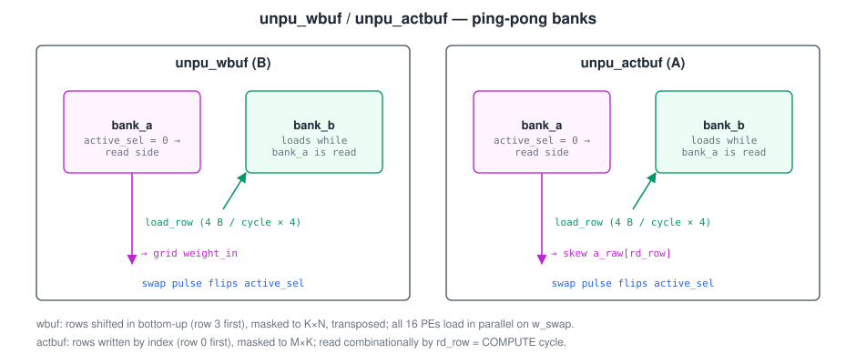

Both buffers have two banks. One is **active** (read by the datapath), the other **loads** from the DMA. A one-cycle `swap` pulse flips `active_sel`. Each load takes exactly 4 cycles (one row per cycle), and rows beyond the real size are **masked to zero**, so a 2×3 job runs through the same 4×4 hardware with zero padding.

**Weights (`unpu_wbuf`)** shift in bottom-up (row 3 first) and are transposed on the way out. On `w_swap` every PE's `weight_load` fires together, so all 16 weights load in **one cycle**:

```systemverilog
assign masked_row[c] = (row_idx >= eff_k) ? 8'h00 :            // beyond K rows
                       ((c >= eff_n)      ? 8'h00 : load_row[c]); // beyond N cols

assign weight_load   = swap ? '1 : '0;                  // all 16 PEs at once
assign effective_sel = active_sel ^ (swap && array_en); // show the NEW bank on the swap cycle
assign weight_in[r][c] = active_bank[c][r];             // transpose
```

**Activations (`unpu_actbuf`)** are written by row index and read with a plain combinational mux, so there is no read latency between `rd_row` and the skew bank:

```systemverilog
bank_b[row_idx[1:0]] <= masked_row;           // write the inactive bank
assign rd_data = active_bank[rd_row];         // 0-latency read
```

### 4.5 `unpu_seq` — the main sequencer

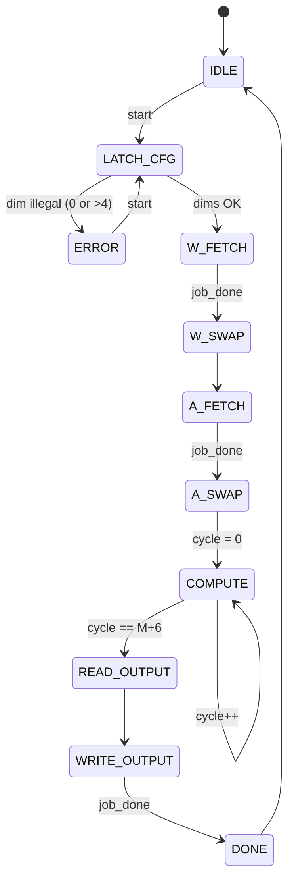

| State | What happens | `array_en` |
|---|---|:---:|
| `LATCH_CFG` | Checks `1 ≤ M,N,K ≤ 4`; copies dims, mode and pointers into shadow registers | 0 |
| `W_FETCH` | Sends a `FETCH_W` job to the DMA (base `src_b`); waits for `job_done` | 1 |
| `W_SWAP` | `w_swap` pulse → weights land in the PEs | 1 |
| `A_FETCH` | Sends a `FETCH_A` job (base `src_a`) | 1 |
| `A_SWAP` | `a_swap` pulse; clears `cycle` | 1 |
| `COMPUTE` | `M + 7` cycles: feeds `rd_row = cycle` for the first M, captures one result row per cycle from cycle 7 | 1 |
| `WRITE_OUTPUT` | Sends a `WRITE_C` job (base `dest_c`) | 1 |
| `DONE` | One-cycle `done` pulse | 0 |
| `ERROR` | Holds `error = 1`, `error_code = 1` until the next start | 0 |

All outputs are **Moore** (functions of `state` only). Three snippets carry most of the logic:

```systemverilog
// 1. job_start fires exactly once per visit to a dispatch state
assign job_start = is_dispatch_state && !job_issued;

// 2. Injection: combinational, so row `cycle` is on the bus during cycle `cycle`
assign rd_row = (state == COMPUTE && cycle < {1'b0, m_lat}) ? cycle[1:0] : 2'd0;

// 3. Capture: row m appears at cycle m + 7
else if (state == COMPUTE && cycle >= 4'd7)
  c_dst[cycle - 4'd7] <= c_in;
```

### 4.6 `unpu_dma` — the bus master

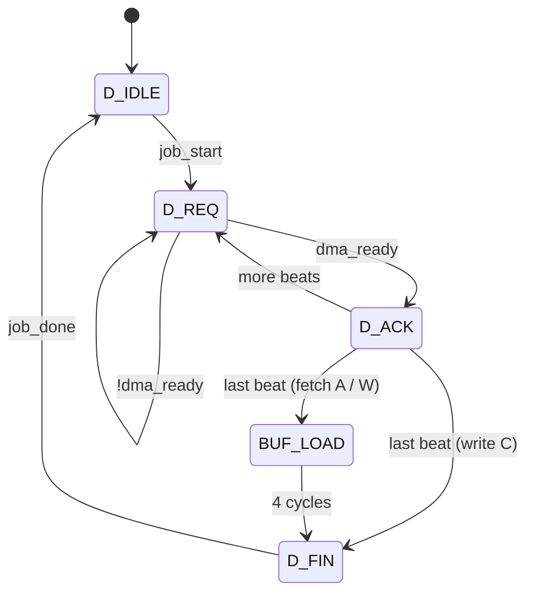

One FSM serves three job kinds (`job_kind`: `0` = FETCH_A, `1` = FETCH_W, `2` = WRITE_C). Reads land in a 4-word `stage` register file and are then streamed into the right buffer in `BUF_LOAD`. Weights are streamed in reverse row order to match `unpu_wbuf`'s bottom-up shift.

```systemverilog
assign total_beats = (kind_lat == JOB_FETCH_A) ? m_lat :      // one word per row of A
                     (kind_lat == JOB_FETCH_W) ? k_lat :      // one word per row of B
                                                 m_lat * n_lat; // one word per element of C

assign dma_valid = (state == D_REQ);
assign dma_wstrb = (state == D_REQ && kind_lat == JOB_WRITE_C) ? 4'hF : 4'h0;
assign dma_addr  = (kind_lat == JOB_WRITE_C)
                 ? base_lat + cur_m*16 + cur_j*4      // C: fixed 16-byte row stride
                 : base_lat + beat_idx*4;             // A, B: consecutive words

// D_ACK: read data is sampled one cycle after the valid & ready handshake
if (kind_lat != JOB_WRITE_C) stage[beat_idx[1:0]] <= dma_rdata;
```

### 4.7 `unpu_csr` — registers

| Offset | `csr_sel` | Name | Access | Bits |
|---|:---:|---|:---:|---|
| `0x00` | 0 | `src_a` | R/W | SRAM byte address of A |
| `0x04` | 1 | `src_b` | R/W | SRAM byte address of B |
| `0x08` | 2 | `dest_c` | R/W | SRAM byte address of C |
| `0x0C` | 3 | `dim_m` | R/W | `[2:0]`, legal 1–4 |
| `0x10` | 4 | `dim_n` | R/W | `[2:0]`, legal 1–4 |
| `0x14` | 5 | `dim_k` | R/W | `[2:0]`, legal 1–4 |
| `0x18` | 6 | `npu_ctrl` | R/W | `[0]` START (write-1-to-pulse, reads 0) · `[1]` SIGNED (1 = signed) |
| `0x1C` | 7 | `npu_status` | RO | `[0]` DONE (sticky) · `[1]` ERROR · `[4:2]` error_code |
| other | 8–1023 | — | — | reads 0, writes ignored |

> The 8-register list is PM-directed; the **offsets are Planning's proposal and not yet PM-confirmed**.

```systemverilog
// START: a one-cycle pulse, registered one cycle after the write
start_pulse <= csr_wen && (csr_sel == SEL_NPU_CTRL) && csr_wdata[0];

// DONE: sticky until the next start, so firmware can poll at its own pace
if      (start_pulse) status_done_reg <= 1'b0;
else if (done_i)      status_done_reg <= 1'b1;

// SIGNED bit is stored as written; the PE wants the opposite polarity
assign mode_unsigned = ~ctrl_signed_reg;
```

### 4.8 `unpu_apb` — the bus slave

Five assignments, no flops. Every access completes in the ACCESS phase with no wait states and no `PSLVERR`. A config register never needs to stall the CPU, and the SPI debug master must never hang.

```systemverilog
assign pready    = 1'b1;
assign csr_sel   = paddr[11:2];               // word offset in the 4 KB window
assign csr_wdata = pwdata;
assign csr_wen   = psel && penable && pwrite; // commit in ACCESS, never in SETUP
assign prdata    = csr_rdata;
```

---

## 5. Protocols

Five handshakes connect the blocks. The first two leave the macro, the rest are internal.

### 5.1 APB (CPU → NPU)

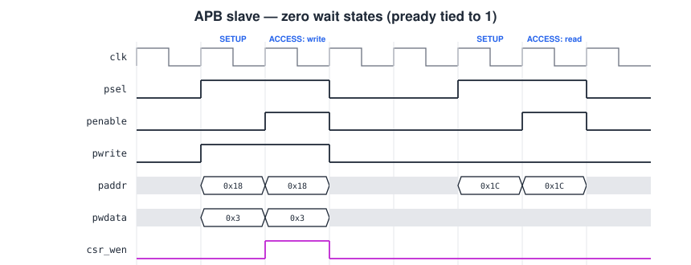

Standard two-phase APB: SETUP (`psel=1, penable=0`), then ACCESS (`psel=1, penable=1`). `pready` is always 1, so every transfer is exactly two cycles. The external address decoder asserts `psel` only for addresses in `0x4000_0xxx`, and the slave decodes only `paddr[11:2]`. All writes are full 32-bit words (no `PSTRB`).

### 5.2 Native valid/ready (NPU → SRAM)

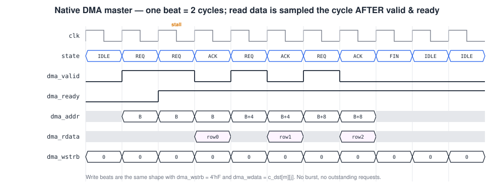

| Signal | Dir | Meaning |
|---|:---:|---|
| `dma_valid` | out | Request is on the bus (high only in `D_REQ`) |
| `dma_ready` | in | Arbiter accepts it this cycle; `dma_valid` holds until it does |
| `dma_addr` | out | Byte address, word aligned |
| `dma_wstrb` | out | `4'hF` = write, `4'h0` = read |
| `dma_wdata` | out | Write data (`c_dst[m][j]`) |
| `dma_rdata` | in | **Sampled the cycle after** `valid & ready` |

One transfer at a time, no bursts. Each beat takes at least 2 cycles (`D_REQ` + `D_ACK`). The arbiter can stall any beat for as long as it likes by holding `dma_ready` low.

### 5.3 Internal job handshake, end to end

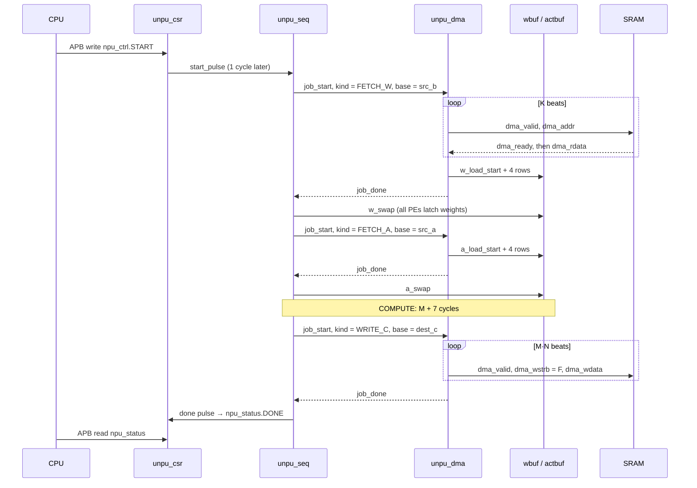

| Handshake | Shape | Rule |
|---|---|---|
| `start_pulse` | CSR → SEQ, 1-cycle pulse | Sampled only in `IDLE` or `ERROR` |
| `job_start` / `job_done` | SEQ ↔ DMA, pulse / pulse | `job_kind`, `job_base_addr`, `job_m/n/k` latched by the DMA on `job_start` |
| `*_load_start` + 4 × `*_load_row` | DMA → buffer | Row data must be on `load_row` in the same cycle as `load_start` |
| `w_swap` / `a_swap` | SEQ → buffer, 1-cycle pulse | Only after the load has finished |
| `array_en` | SEQ → whole datapath, level | 0 freezes every datapath flop |

---

## 6. Memory layout

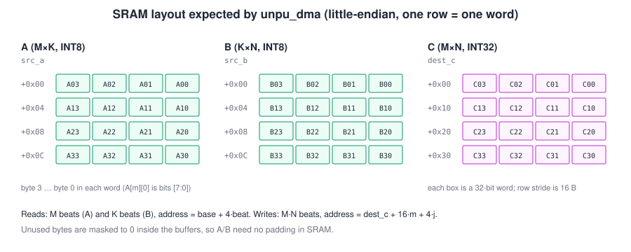

- **A and B** are stored **one row per 32-bit word**, little-endian: element `[r][0]` is bits `[7:0]`. Row `r` is at `base + 4r`. Unused bytes (columns ≥ K or N) are masked inside the buffers, so they can hold anything.
- **C** is written as INT32, one word per element, at `dest_c + 16·m + 4·j`. The row stride is fixed at 16 bytes whatever N is, so leave a 4×4-word (64-byte) region for C.

---

## 7. Timing and performance

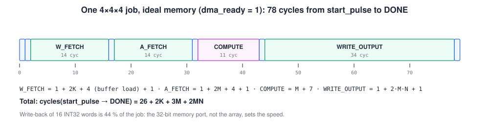

These counts come from a cycle model of `unpu_seq` + `unpu_dma` with `dma_ready` held at 1, and the model's C matches the golden product. Add 1 cycle from the START write to `start_pulse` and 1 from `done` to the status bit.

| M × N × K | Cycles to DONE | Ops (2MNK) | Effective throughput at 50 MHz |
|---|---:|---:|---:|
| 1 × 1 × 1 | 33 | 2 | 3 MOPS |
| 2 × 2 × 2 | 44 | 16 | 18 MOPS |
| 4 × 4 × 1 | 72 | 32 | 22 MOPS |
| **4 × 4 × 4** | **78** | **128** | **82 MOPS** |

The array only works for `M + 7` of those cycles. **The single 32-bit memory port is the bottleneck**: writing 16 INT32 results takes 34 cycles, almost half the job. Packing outputs to INT8 or overlapping fetch with compute would speed it up far more than any change to the array.

---

## 8. Programming it from firmware

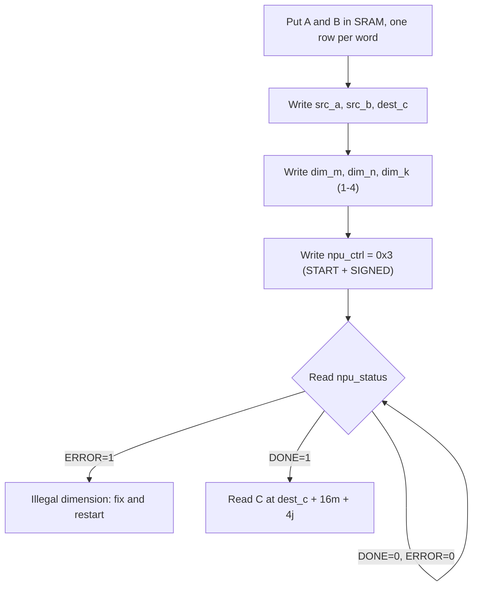

```c
#include <stdint.h>
#define NPU_BASE   0x40000000u
#define NPU(off)   (*(volatile uint32_t *)(NPU_BASE + (off)))
#define SRC_A      0x00
#define SRC_B      0x04
#define DEST_C     0x08
#define DIM_M      0x0C
#define DIM_N      0x10
#define DIM_K      0x14
#define NPU_CTRL   0x18   /* bit0 START, bit1 SIGNED */
#define NPU_STATUS 0x1C   /* bit0 DONE, bit1 ERROR, [4:2] code */

int npu_matmul(uint32_t a, uint32_t b, uint32_t c, int m, int n, int k)
{
    NPU(SRC_A) = a;  NPU(SRC_B) = b;  NPU(DEST_C) = c;
    NPU(DIM_M) = m;  NPU(DIM_N) = n;  NPU(DIM_K)  = k;
    NPU(NPU_CTRL) = 0x3;                       /* signed INT8, go */
    uint32_t s;
    while (((s = NPU(NPU_STATUS)) & 0x3) == 0) /* wait for DONE or ERROR */
        ;
    return (s & 0x2) ? -(int)((s >> 2) & 0x7) : 0;
}
```

The SIGNED bit resets to **0**, which means **unsigned**. Firmware that wants signed INT8 must set bit 1 on every START write.

---

## 9. Worked example

`A` at `0x1200`, `B` at `0x1000`, `C` to `0x1400`, all 4×4, signed:

```
A = [[1,2,3,4],[2,1,0,3],[0,4,1,1],[3,0,2,2]]
B = [[1,0,2,1],[0,1,1,2],[2,1,0,1],[1,2,1,0]]
C = [[11,13,8,8],[5,7,8,4],[3,7,5,9],[9,6,8,5]]
```

| Address | Word | Holds |
|---|---|---|
| `0x1000` | `0x01020001` | B row 0 |
| `0x1004` | `0x02010100` | B row 1 |
| `0x1008` | `0x01000102` | B row 2 |
| `0x100C` | `0x00010201` | B row 3 |
| `0x1200` | `0x04030201` | A row 0 |
| `0x1204` | `0x03000102` | A row 1 |
| `0x1208` | `0x01010400` | A row 2 |
| `0x120C` | `0x02020003` | A row 3 |

Result: `C[0][0] = 11` at `0x1400`, `C[0][1] = 13` at `0x1404`, …, `C[3][3] = 5` at `0x143C`. With an always-ready memory, DONE is reached 78 cycles after `start_pulse`.

**Bug signatures** worth recognising when a test fails (same A and B):

| Bug | What you see |
|---|---|
| No input skew | `[[5,6,5,4],[6,6,8,12],[0,0,0,0],[3,0,6,3]]` (a row of zeros) |
| Weights loaded top-first | `A × flipud(B)` = `[[9,7,12,12],…]`, plausible and wrong |
| Address advances on `valid` instead of `valid & ready` | Passes with `dma_ready = 1`, fails under back-pressure |
| DONE not cleared by a new START | Second job appears to finish instantly |

---

## 10. Design rules and known traps

1. **Depth-0 lanes are wires.** Row 0 of `unpu_skew` and column 3 of `unpu_deskew` must not be registered. One extra flop shifts every result by a row.
2. **`rd_row` must be combinational.** If it were registered from `cycle`, row `m` would arrive one cycle late. `unpu_actbuf`'s read is also combinational, so the whole injection path has zero latency.
3. **`job_issued` flag.** `job_start` must fire once per visit to a dispatch state, even if the DMA takes 100 cycles to finish. Without the flag the DMA would be re-triggered every cycle.
4. **SIGNED polarity.** The register bit means *signed*; the PE port means *unsigned*. The inversion lives in exactly one place (`unpu_csr`).
5. **Read data timing.** `dma_rdata` is used in `D_ACK`, the cycle after the handshake. The SRAM side must agree with this.
6. **One `array_en`.** No per-row or per-column enables anywhere in the datapath. A stall freezes everything together, which keeps the wavefront intact.
7. **Timing contract is cross-cutting.** Pipelining the PE (needed only above ~130 MHz) changes the skew depths, the capture cycle and the `M + 6` exit check. Treat it as a design-wide change.

---

## 11. Limits and open items

- **One 4×4×4 tile per job.** Larger matrices are tiled in firmware. The north-edge `psum_in` is tied to 0, so there is no hardware accumulation across K tiles; firmware adds partial results.
- **INT32 output only**; no requantisation, ReLU or INT8 packing in hardware.
- **No interrupt pin**: firmware polls `npu_status`.
- **Register offsets** are provisional until the PM confirms them.
- **No DMA timeout**: a memory that never raises `dma_ready` hangs the job. Only error code 1 (illegal dimension) is implemented.

Testbenches for every module are in [`../tb/`](../tb/): unit tests (`unpu_pe_tb`, `unpu_grid_tb`, `unpu_skew_tb`, `unpu_buf_tb`, `unpu_dma_tb`, `unpu_seq_tb`, `unpu_csr_tb`, `unpu_apb_tb`), stall/back-pressure (`unpu_stall_tb`) and full-macro tests (`unpu_top_tb`, `unpu_ext1_tb`, `unpu_ext2_tb`).
