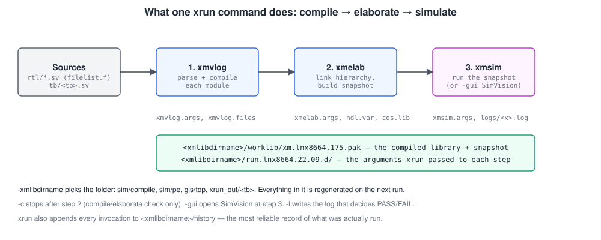
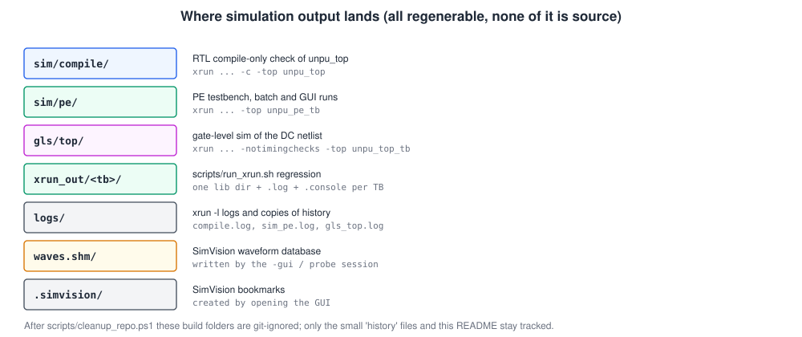
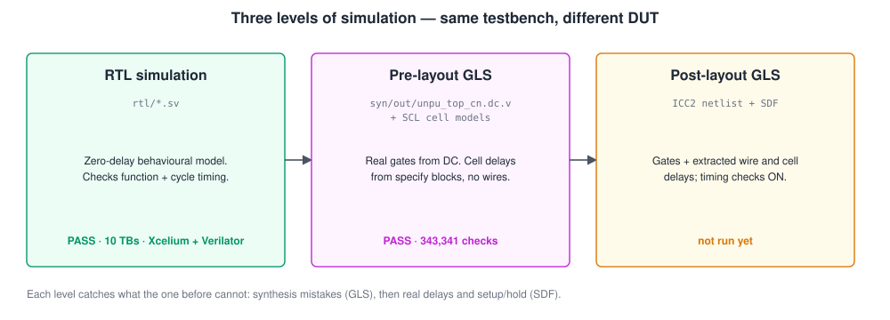
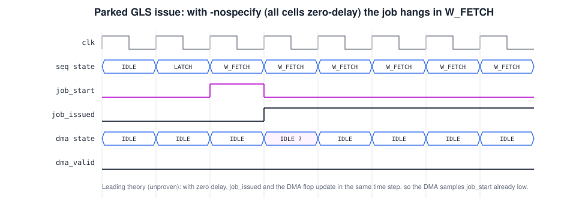
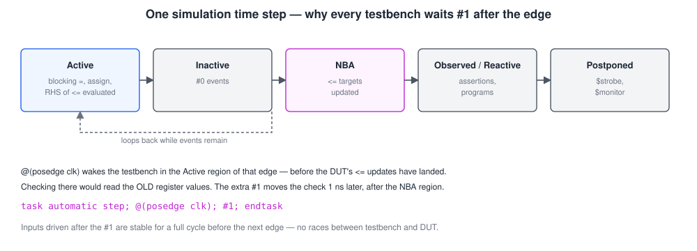

# uNPU simulation — how to run it, and what is in this folder

This folder holds the **output of Cadence Xcelium simulation runs** of the uNPU. It does not hold sources: the design is in [`../rtl/`](../rtl/) and the testbenches are in [`../tb/`](../tb/). This README gives the **exact commands** to reproduce every run, explains what Xcelium writes here, and covers the simulation concepts behind it: RTL simulation, gate-level simulation (GLS) and waveforms.

> A longer, from-first-principles version of this guide, with the same figures, is in **[`uNPU_simulation_from_scratch.pdf`](uNPU_simulation_from_scratch.pdf)**. Testbench internals are explained in [`../tb/README.md`](../tb/README.md).

| | |
|---|---|
| Simulator | Cadence Xcelium 22.09-s003 (`xrun`) on the institute server; Verilator 5.053 locally |
| Folders written by runs | `sim/compile/`, `sim/pe/`, `gls/top/`, `xrun_out/`, `logs/`, `waves.shm/`, `.simvision/` |
| RTL simulation | all testbenches **pass** on both simulators (counts in `../tb/README.md`) |
| Pre-layout GLS | `unpu_top_tb` on the DC netlist: **pass**, 343 341 checks, identical to RTL |
| Post-layout GLS (SDF) | **not run yet**; a command template is in [section 7](#7-gate-level-simulation-gls) |

---

## Contents

1. [Quick start: the five commands you need most](#1-quick-start)
2. [One-time setup on the server](#2-one-time-setup-on-the-server)
3. [What `xrun` does, and what it writes here](#3-what-xrun-does-and-what-it-writes-here)
4. [RTL simulation: exact command for every testbench](#4-rtl-simulation-exact-command-for-every-testbench)
5. [The regression script](#5-the-regression-script)
6. [Waveforms and the GUI](#6-waveforms-and-the-gui)
7. [Gate-level simulation (GLS)](#7-gate-level-simulation-gls)
8. [Running locally with Verilator](#8-running-locally-with-verilator)
9. [Reading a log, and troubleshooting](#9-reading-a-log-and-troubleshooting)
10. [Cleaning up](#10-cleaning-up)
11. [Concepts: why the testbenches wait `#1`](#11-concepts-why-the-testbenches-wait-1)

---

## 1. Quick start

Run everything **from the repository root**. The testbenches open `model/vectors/...` by relative path, and the commands below use relative paths too.

```bash
source ~/cad_cshrc                                                       # Cadence environment (csh)
gcc -std=c99 -Wall -Wextra -o model/golden model/golden.c && ./model/golden   # golden vectors, once
bash scripts/run_xrun.sh                                                  # all ten RTL testbenches
xrun -sv -64bit -access +r -timescale 1ns/1ps -top unpu_pe_tb -xmlibdirname sim/pe -l logs/sim_pe.log -f scripts/filelist.f tb/unpu_pe_tb.sv -gui   # one TB in SimVision
xrun -sv -64bit -access +r -timescale 1ns/1ps -notimingchecks -top unpu_top_tb -xmlibdirname gls/top -l logs/gls_top.log syn/out/unpu_top_cn.dc.v /storage/PDK_iitg/SCLPDK_V3.0_KIT/scl180/stdcell/fs120/4M1IL/verilog/vcs_sim_model/tsl18fs120_scl.v tb/unpu_top_tb.sv   # GLS
```

Commands marked **(from history)** below are copied character for character from the `history` files Xcelium wrote in this folder, so they are exactly what was run on 15 Oct 2026. The others follow the same pattern.

---

## 2. One-time setup on the server

```bash
# 1. Log in to the institute server (the runs here were on lalita.iitg.ac.in) and go to your clone
cd /storage/EE5239G1/<your_work_dir>/unpu_flow        # the history files show .../Uditya_Work/unpu_flow
git pull --ff-only

# 2. Load Xcelium. The login shell is csh; this file sets PATH and the license.
source ~/cad_cshrc
which xrun                     # expect .../XCELIUM2209/tools/... /bin/xrun
xrun -version                  # expect TOOL: xrun(64) 22.09-s003

# 3. Generate the golden vectors (git-ignored, so needed once per fresh clone)
gcc -std=c99 -Wall -Wextra -o model/golden model/golden.c
./model/golden                 # must end with: ALL CASES PASSED AND WRITTEN
ls model/vectors | wc -l       # expect 292
```

`scripts/run_xrun.sh` is a bash script. Run it with `bash scripts/...` from the csh prompt and it inherits the environment set up by `source ~/cad_cshrc`.

---

## 3. What `xrun` does, and what it writes here



`xrun` is a wrapper that runs three Xcelium tools in a row:

| Step | Tool | Does | Its arguments are saved in |
|---|---|---|---|
| 1 | `xmvlog` | Parses and compiles every `.sv` file | `run.lnx8664.22.09.d/xmvlog.args`, `xmvlog.files` |
| 2 | `xmelab` | Links the hierarchy below `-top`, builds a **snapshot** | `xmelab.args`, `hdl.var`, `cds.lib` |
| 3 | `xmsim` | Runs the snapshot (in batch, or in SimVision with `-gui`) | `xmsim.args` |

The flags used throughout this project:

| Flag | Meaning |
|---|---|
| `-sv` | Treat all sources as SystemVerilog |
| `-64bit` | 64-bit simulator binary |
| `-access +r` | Keep signals readable, needed for waveforms and hierarchical probes in the testbenches |
| `-timescale 1ns/1ps` | Default time unit for RTL files that have no `` `timescale `` (the testbenches have their own) |
| `-top <name>` | The top-level module to elaborate |
| `-xmlibdirname <dir>` | Where to put the compiled library and run files (this is what creates `sim/pe/` etc.) |
| `-f scripts/filelist.f` | Read the 11 RTL file names from a file |
| `-l <file>` | Write the log, the file PASS/FAIL is judged from |
| `-c` | Compile and elaborate only, don't simulate |
| `-gui` | Open SimVision instead of running in batch |
| `-notimingchecks` | GLS: keep cell delays, turn off setup/hold checks |
| `-input <file.tcl>` | Run Tcl commands in the simulator (used for waveform dumps) |



**What each folder in a run directory contains:**

| Path | What it is |
|---|---|
| `<dir>/history` | Every `xrun` command run with this lib dir, with a timestamp. **Keep it**; it is the record of what was run |
| `<dir>/worklib/xm.lnx8664.175.pak` | The compiled design and snapshot (MBs to tens of MBs) |
| `<dir>/run.lnx8664.22.09.d/*.args` | The exact arguments `xrun` passed to `xmvlog`, `xmelab`, `xmsim` |
| `<dir>/run.lnx8664.22.09.d/xmvlog.files` | Absolute paths of every compiled source |
| `<dir>/run.lnx8664.22.09.d/cds.lib`, `hdl.var` | Library mapping and variables (`worklib`, snapshot name) |
| `<dir>/run.lnx8664.22.09.d/*.lock`, `*.ts`, `temp/` | Locks and timestamps; safe to delete |

All of it is regenerated by the next run. After `scripts/cleanup_repo.ps1`, git ignores `run.lnx8664.*/` and `worklib/`.

---

## 4. RTL simulation: exact command for every testbench

Pattern: `-f scripts/filelist.f` supplies the RTL, then the testbench file, with its own lib dir and log. Testbenches that need fewer RTL modules ignore the unused ones.

**Compile-only check of the whole RTL** (from history, `sim/compile/`):

```bash
xrun -sv -64bit -c -top unpu_top -f scripts/filelist.f -xmlibdirname sim/compile -l logs/compile.log
```

**PE testbench, batch, then GUI** (from history, `sim/pe/`):

```bash
xrun -sv -64bit -access +r -timescale 1ns/1ps -top unpu_pe_tb -xmlibdirname sim/pe -l logs/sim_pe.log -f scripts/filelist.f tb/unpu_pe_tb.sv
xrun -sv -64bit -access +r -timescale 1ns/1ps -top unpu_pe_tb -xmlibdirname sim/pe -l logs/sim_pe.log -f scripts/filelist.f tb/unpu_pe_tb.sv -gui
```

**Every testbench** (same pattern; one lib dir and log per testbench):

```bash
xrun -sv -64bit -access +r -timescale 1ns/1ps -top unpu_pe_tb    -xmlibdirname sim/pe    -l logs/sim_pe.log    -f scripts/filelist.f tb/unpu_pe_tb.sv
xrun -sv -64bit -access +r -timescale 1ns/1ps -top unpu_grid_tb  -xmlibdirname sim/grid  -l logs/sim_grid.log  -f scripts/filelist.f tb/unpu_grid_tb.sv
xrun -sv -64bit -access +r -timescale 1ns/1ps -top unpu_skew_tb  -xmlibdirname sim/skew  -l logs/sim_skew.log  -f scripts/filelist.f tb/unpu_skew_tb.sv
xrun -sv -64bit -access +r -timescale 1ns/1ps -top unpu_stall_tb -xmlibdirname sim/stall -l logs/sim_stall.log -f scripts/filelist.f tb/unpu_stall_tb.sv
xrun -sv -64bit -access +r -timescale 1ns/1ps -top unpu_buf_tb   -xmlibdirname sim/buf   -l logs/sim_buf.log   -f scripts/filelist.f tb/unpu_buf_tb.sv
xrun -sv -64bit -access +r -timescale 1ns/1ps -top unpu_dma_tb   -xmlibdirname sim/dma   -l logs/sim_dma.log   -f scripts/filelist.f tb/unpu_dma_tb.sv
xrun -sv -64bit -access +r -timescale 1ns/1ps -top unpu_seq_tb   -xmlibdirname sim/seq   -l logs/sim_seq.log   -f scripts/filelist.f tb/unpu_seq_tb.sv
xrun -sv -64bit -access +r -timescale 1ns/1ps -top unpu_csr_tb   -xmlibdirname sim/csr   -l logs/sim_csr.log   -f scripts/filelist.f tb/unpu_csr_tb.sv
xrun -sv -64bit -access +r -timescale 1ns/1ps -top unpu_apb_tb   -xmlibdirname sim/apb   -l logs/sim_apb.log   -f scripts/filelist.f tb/unpu_apb_tb.sv
xrun -sv -64bit -access +r -timescale 1ns/1ps -top unpu_top_tb   -xmlibdirname sim/top   -l logs/sim_top.log   -f scripts/filelist.f tb/unpu_top_tb.sv
xrun -sv -64bit -access +r -timescale 1ns/1ps -top unpu_ext1_tb  -xmlibdirname sim/ext1  -l logs/sim_ext1.log  -f scripts/filelist.f tb/unpu_ext1_tb.sv
xrun -sv -64bit -access +r -timescale 1ns/1ps -top unpu_ext2_tb  -xmlibdirname sim/ext2  -l logs/sim_ext2.log  -f scripts/filelist.f tb/unpu_ext2_tb.sv
```

Each run should end with the testbench's own verdict line:

| Testbench | Final line in the log |
|---|---|
| `pe` | `ALL TASK 013 + TASK 019 PE CHECKS PASSED ...` |
| `grid` | `ALL TASK 013 + TASK 020 GRID CHECKS PASSED ... checked=12474 total` |
| `skew` | `ALL TASK 013 + TASK 021 SKEW/DESKEW CHECKS PASSED ... checked=17665 total` |
| `stall` | `ALL TASK 005/013 + TASK 022 STALL CHECKS PASSED ... checks=5732 frozen_checks=250560` |
| `buf`, `dma`, `csr`, `seq`, `apb`, `top` | `checked <N> value(s)/assertion(s) total` then `ALL CHECKS PASSED` |
| `ext1`, `ext2` | `ALL TESTS PASSED` |

---

## 5. The regression script

[`../scripts/run_xrun.sh`](../scripts/run_xrun.sh) runs the testbenches above in a loop, each in `xrun_out/<tb>/`, and prints a PASS/FAIL table with check counts.

```bash
bash scripts/run_xrun.sh                  # the ten frozen TBs: pe grid skew stall buf dma csr seq apb top
bash scripts/run_xrun.sh dma seq top      # just these
bash scripts/run_xrun.sh ext1 ext2        # the two adapted peer TBs (not in the default list)
XRUN_FLAGS="-licqueue" bash scripts/run_xrun.sh top   # extra flags for every xrun call
echo $?                                   # 0 = all passed, 1 = a TB failed, 2 = setup problem
```

Inside, each testbench is run with exactly:

```bash
xrun -sv -64bit -access +r -timescale 1ns/1ps -top unpu_<tb>_tb -xmlibdirname xrun_out/<tb> \
     -l xrun_out/<tb>.log ${XRUN_FLAGS} rtl/*.sv tb/unpu_<tb>_tb.sv > xrun_out/<tb>.console 2>&1
```

A testbench **fails** if its log contains `*E,` or `*F,` (Xcelium error/fatal), `FAIL`, or `$fatal`, or **lacks** its final ALL-PASSED line, or the log is missing. The xrun exit code is ignored because `$finish` exits 0 even after failed checks.

---

## 6. Waveforms and the GUI

**Interactive** (from history): add `-gui`. SimVision opens with the design loaded; select signals, *Send to Waveform*, then *Run*.

```bash
xrun -sv -64bit -access +r -timescale 1ns/1ps -top unpu_pe_tb -xmlibdirname sim/pe -l logs/sim_pe.log -f scripts/filelist.f tb/unpu_pe_tb.sv -gui
```

**Batch dump, then view.** [`waves.tcl`](waves.tcl) in this folder opens an SHM database, probes everything, runs to the end and closes:

```bash
xrun -sv -64bit -access +r -timescale 1ns/1ps -top unpu_seq_tb -xmlibdirname sim/seq -l logs/sim_seq.log -f scripts/filelist.f tb/unpu_seq_tb.sv -input sim/waves.tcl
simvision waves.shm &
```

`-access +r` is required for both: without read access the simulator optimises signals away and they cannot be probed. For the very long `unpu_top_tb` run, reduce `-depth all` in `waves.tcl` (for example to `-depth 3`), or the database becomes very large.

Useful signals for a first look at a job (`unpu_seq_tb`): `u_seq.state`, `u_seq.cycle`, `u_dma.state`, `dma_valid`, `dma_ready`, `dma_addr`, `u_seq.array_en`, `u_seq.rd_row`, `deskew_c_out`.

---

## 7. Gate-level simulation (GLS)



**Pre-layout GLS** runs the *same* black-box testbench, `tb/unpu_top_tb.sv`, against the Design Compiler netlist instead of the RTL. It checks that synthesis did not change the design's behaviour. Exact command (from history, `gls/top/`):

```bash
xrun -sv -64bit -access +r -timescale 1ns/1ps -notimingchecks -top unpu_top_tb \
     -xmlibdirname gls/top -l logs/gls_top.log \
     syn/out/unpu_top_cn.dc.v \
     /storage/PDK_iitg/SCLPDK_V3.0_KIT/scl180/stdcell/fs120/4M1IL/verilog/vcs_sim_model/tsl18fs120_scl.v \
     tb/unpu_top_tb.sv
```

| Input | Why |
|---|---|
| `syn/out/unpu_top_cn.dc.v` | The cleaned DC netlist (no escaped names, no `assign`), the ICC2 hand-off |
| `.../vcs_sim_model/tsl18fs120_scl.v` | Behavioural models of every SCL standard cell. Pass **only this combined file**, not the per-cell files too (duplicate modules) |
| `tb/unpu_top_tb.sv` | Unchanged; it only touches the APB and DMA ports, so it works on a netlist |
| `-notimingchecks` | Cell delays from the models' `specify` blocks stay **on**; setup/hold checks are **off** (no SDF yet, so they would be meaningless) |

**Result (12 and 14 Oct 2026):** `ALL CHECKS PASSED`, 343 341 checks, the same as the RTL run. `$finish` came at 138 350 796 ns, after 1 min 57 s of wall time. Two kinds of benign messages appear: 24 × `CUVWSP` (DC left unused output ports unconnected) and 1 × `UDPRDT` (a redundant row in a cell model). There were no unresolved cells.

**Do not use `-nospecify`.** With all cell delays removed the same run **fails**: the sequencer reaches `W_FETCH` and `dma_valid` never rises. The leading, unproven theory is a zero-delay race on the one-cycle `job_start` pulse. Neither the RTL nor the netlist is implicated: the RTL run and the run with cell delays both pass.



**VCS** (U-2023.03) does not compile `unpu_top_tb.sv`: it reports `ICPD` errors, because `mem` and `bp_rng` are written from an `always_ff` and from other processes. Xcelium accepts this. Use Xcelium for GLS.

**Post-layout GLS (not run yet).** Once ICC2 writes the routed netlist and an SDF, the run adds real wire and cell delays and turns timing checks **on**. The file names below are placeholders until ICC2 produces them:

```bash
# 1. compile the SDF once
xmsdfc pnr/out/unpu_top.sdf -output pnr/out/unpu_top.sdf.X

# 2. sim/sdf_post.cmd  (create this file)
#      COMPILED_SDF_FILE = "pnr/out/unpu_top.sdf.X",
#      SCOPE = unpu_top_tb.dut,
#      LOG_FILE = "logs/sdf_post.log",
#      MTM_CONTROL = "MAXIMUM";

# 3. run, with timing checks ON (no -notimingchecks)
xrun -sv -64bit -access +r -timescale 1ns/1ps -top unpu_top_tb \
     -xmlibdirname gls/post -l logs/gls_post.log -sdf_cmd_file sim/sdf_post.cmd \
     pnr/out/unpu_top.pnr.v \
     /storage/PDK_iitg/SCLPDK_V3.0_KIT/scl180/stdcell/fs120/4M1IL/verilog/vcs_sim_model/tsl18fs120_scl.v \
     tb/unpu_top_tb.sv
```

Check `logs/sdf_post.log` for annotation coverage (every instance should be annotated), then run again with `MTM_CONTROL = "MINIMUM"` for the hold corner.

---

## 8. Running locally with Verilator

The testbenches were developed on Verilator 5.053, which is free and runs on a laptop or WSL. Each testbench gets its own build directory:

```bash
verilator --binary --timing -Wno-fatal --top-module unpu_pe_tb --Mdir obj_dir/pe rtl/*.sv tb/unpu_pe_tb.sv
./obj_dir/pe/Vunpu_pe_tb
```

Replace `pe` with any of `grid skew stall buf dma seq csr apb top ext1 ext2`. Lint the RTL with:

```bash
verilator --lint-only -Wall --top-module unpu_top rtl/*.sv     # expect exactly 4 GENUNNAMED warnings in unpu_grid.sv
```

Verilator is two-state and more lenient than Xcelium. Three testbench defects were found only when the suite first ran on Xcelium, so treat Xcelium as the reference.

---

## 9. Reading a log, and troubleshooting

```bash
grep -E "ALL .*PASSED|ALL TESTS PASSED" logs/sim_pe.log      # the verdict line
grep -cE "\*E,|\*F," logs/sim_pe.log                           # Xcelium errors/fatals: must be 0
grep -c FAIL logs/sim_pe.log                                   # failed checks: must be 0
grep -E "\*W," logs/sim_pe.log                                 # warnings (2 informational ones are normal)
tail -n 20 logs/sim_pe.log                                     # check counts and $finish time
```

| Symptom | Cause | Fix |
|---|---|---|
| `$fatal: could not open model/vectors/..._meta.txt -- run model/golden first` | Vectors not generated, or not running from the repo root | Run the golden model (section 2); `cd` to the repo root |
| `xrun: command not found` | Cadence environment not loaded | `source ~/cad_cshrc` |
| `*E,UNDIDN` (undeclared identifier) | Old testbench version | `git pull`; fixed in task 030 |
| Two `*W` lines in every run | Reported as IEEE 1800-2009 semantics notices (`DSEMEL` / `DSEM2009`) | Informational; present in every passing run |
| Log ends without a verdict line | Simulation stopped early (compile error, or a bounded wait hit its cap) | Look for the first `*E` or `FAIL` line |
| GLS: `DONE never observed`, `mem C = x` | Ran with `-nospecify` | Remove `-nospecify` |
| GLS: unresolved cell / duplicate module | Wrong or extra cell model files | Pass only `tsl18fs120_scl.v` |
| License wait | All Xcelium licenses busy | `XRUN_FLAGS="-licqueue"` or retry |

---

## 10. Cleaning up

Everything Xcelium writes can be regenerated. To free space (the GLS library alone is about 26 MB):

```bash
rm -rf sim/*/worklib sim/*/run.lnx8664.* sim/*/*.lock sim/*/pakvst.ts sim/*/.history.lock
rm -rf gls/top/worklib gls/top/run.lnx8664.* gls/top/pakvst.ts gls/top/.history.lock
rm -rf xrun_out waves.shm .simvision
```

Keep the `history` files: they are the record of what was run.

---

## 11. Concepts: why the testbenches wait `#1`



A simulator does not run hardware; it processes **events**. At each clock edge, every `always_ff` reads its inputs, and only after all of them have read do their `<=` assignments land (the NBA region). This is what lets a chain of flip-flops shift by exactly one stage per edge.

A testbench that checks a register straight after `@(posedge clk)` can therefore see the **old** value. Every testbench here uses

```systemverilog
task automatic step;  @(posedge clk);  #1;  endtask
```

so checks happen 1 ns after the edge, when every register has settled, and new inputs are driven well before the next edge. That removes all races between testbench and design, on any simulator.
