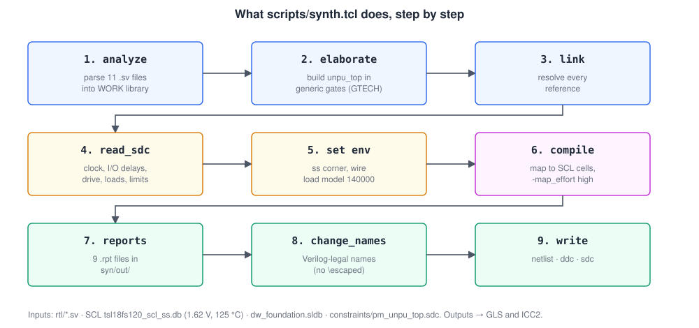
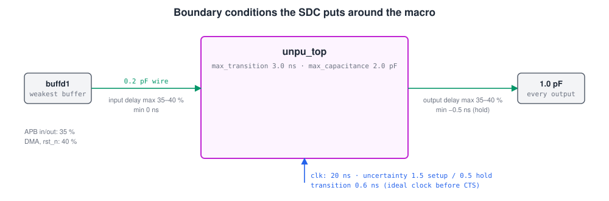
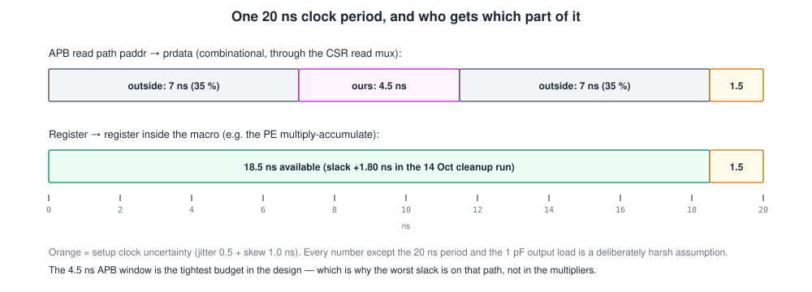
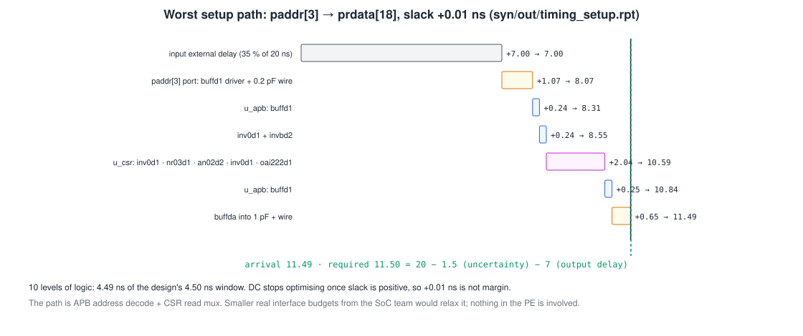
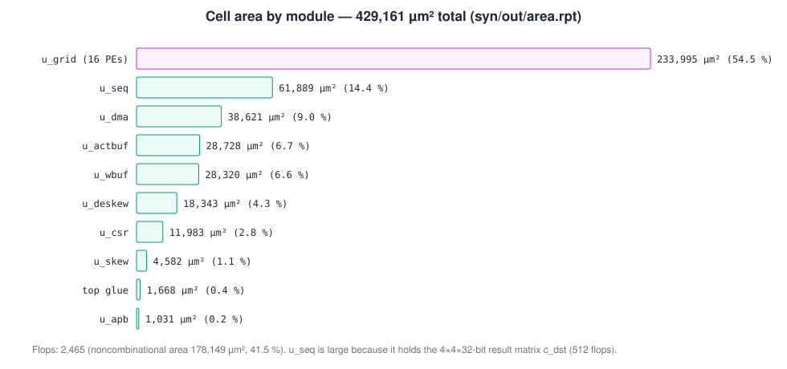
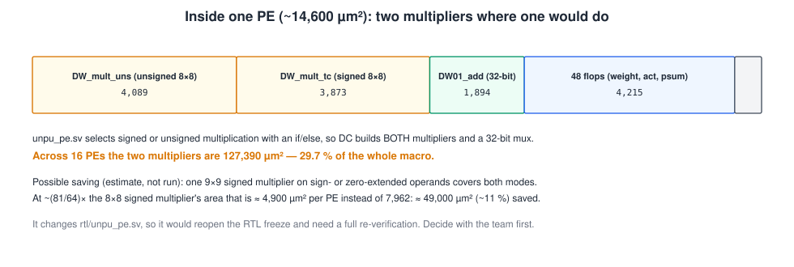
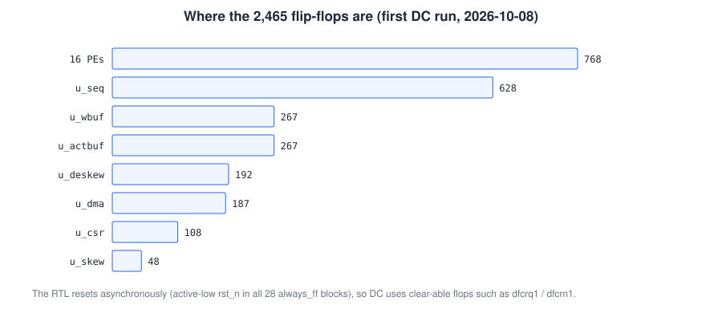
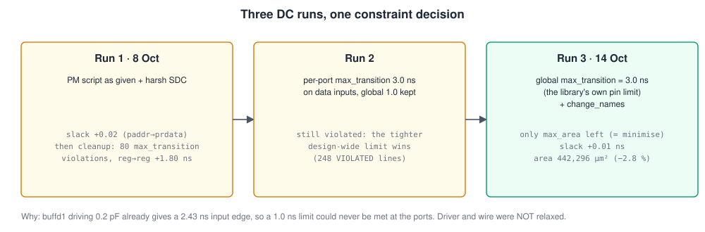

# uNPU synthesis — Design Compiler, SCL 180 nm

This folder turns the RTL in [`../rtl/`](../rtl/) into a **gate-level netlist** of SCL 180 nm standard cells using Synopsys Design Compiler (DC). That netlist is the hand-off to gate-level simulation and to place-and-route in ICC2. This README gives the **exact commands**, explains every constraint and report, and records the results. The results matter here because `syn/out/` is git-ignored, so the reports themselves never reach GitHub.

> A longer, from-first-principles version of this guide, with the same figures, is in **[`uNPU_synthesis_from_scratch.pdf`](uNPU_synthesis_from_scratch.pdf)**.

| | Result (run of 15 Oct 2026, `scripts/synth.tcl`) |
|---|---|
| Tool / library | `dc_shell` T-2022.03-SP5 · `tsl18fs120_scl_ss` (ss: 1.62 V, 125 °C) · wire-load model `140000` |
| Clock | 20 ns (50 MHz), ideal clock, setup uncertainty 1.5 ns |
| Worst setup slack | **+0.01 ns** on the combinational APB read path `paddr` → `prdata` (4.49 of 4.50 ns) |
| Register → register | **+1.80 ns** (PE multiply-accumulate) in the 14 Oct cleanup run; not re-reported since, so confirm with `syn/extra_reports.tcl` |
| Violations | **none** except `max_area` (the PM's `set_max_area 0`, which only means "minimise") |
| Design rules | 0 max-transition, 0 max-capacitance violations on 14 543 nets |
| Area | cell area **429 161 µm²**, total **442 296 µm²** (0.44 mm²) with the wire-load net estimate |
| Cells | 12 487 leaf cells: 10 022 combinational, **2 465 flip-flops**, 0 latches, 0 macros |
| Netlist | `syn/out/unpu_top_cn.dc.v`: no escaped names, no `assign`, no don't-use cells |
| Gate-level sim of this netlist | **PASS**, 343 341 checks, same as RTL ([`../sim/README.md`](../sim/README.md)) |

---

## Contents

1. [Quick start](#1-quick-start)
2. [What is in this folder (and the other synthesis files)](#2-what-is-in-this-folder)
3. [What synthesis does](#3-what-synthesis-does)
4. [The library](#4-the-library)
5. [The constraints, line by line](#5-the-constraints-line-by-line)
6. [The script, step by step](#6-the-script-step-by-step)
7. [Results, report by report](#7-results-report-by-report)
8. [How the constraints got here: three runs](#8-how-the-constraints-got-here-three-runs)
9. [Findings and recommendations](#9-findings-and-recommendations)
10. [Checking a run: the sign-off checklist](#10-checking-a-run-the-sign-off-checklist)
11. [The bring-up flow (`syn/dc_run.tcl`)](#11-the-bring-up-flow-syndc_runtcl)
12. [Troubleshooting](#12-troubleshooting)
13. [What synthesis does not prove](#13-what-synthesis-does-not-prove)

---

## 1. Quick start

On the institute server, in **csh**, from the **repository root**:

```csh
source ~/cad_cshrc
source ~/synopsys_cshrc
which dc_shell                                   # dc_shell T-2022.03-SP5
mkdir -p logs
dc_shell -f scripts/synth.tcl |& tee logs/dc_synth.log
```

It finishes in about half a minute of CPU time (`Overall Compile Wall Clock Time: 31.96` s on 15 Oct). Then:

```csh
grep -c "^Error" logs/dc_synth.log               # must be 0
cat syn/out/violators.rpt                        # only max_area may appear
grep "slack" syn/out/timing_setup.rpt | head -1  # slack (MET) ...
grep "Total cell area" syn/out/area.rpt          # ~429161
ls syn/out/unpu_top_cn.*                         # .dc.v  .ddc  .sdc  -> the hand-off
```

Optional, for the register-to-register paths that the main run's report does not list:

```csh
dc_shell -f syn/extra_reports.tcl |& tee logs/dc_extra.log
```

---

## 2. What is in this folder

| File | Role |
|---|---|
| **`../scripts/synth.tcl`** | **The production flow.** The PM's example DC script adapted to `unpu_top` and SCL. Writes every file in `syn/out/` and the ICC2 hand-off |
| **`../constraints/pm_unpu_top.sdc`** | The constraints it reads. Pure SDC, so ICC2 and PrimeTime read the same file |
| `../constraints/unpu_top.sdc` | Twin of the above, kept identical by hand (read by the bring-up flow) |
| `../constraints/unpu_pe.sdc` | Constraints for synthesising one PE on its own (bring-up flow) |
| `../constraints/pm_dc_script_unpu.tcl` | The earlier copy of the PM script (runs of 8 and 14 Oct); `synth.tcl` supersedes it |
| `dc_setup.tcl` | Bring-up flow: library, link library, don't-use cells, loud error handling |
| `dc_run.tcl` | Bring-up flow: one design (`unpu_pe` or `unpu_top`), plain `compile`, outputs in `syn/out/<design>/` |
| `../scripts/dc_summary.sh` | Bring-up flow: summarises a run (errors, latches, unconstrained paths, slack, don't-use hits) |
| `extra_reports.tcl` | Extra timing reports from the finished `.ddc` (section 1) |
| `out/` | **Generated, git-ignored.** Reports, netlist, `.ddc`, `.sdc` |

The two flows share the library and the constraints but differ in compile effort and outputs. **`scripts/synth.tcl` is the one whose netlist goes to ICC2.** The bring-up flow (section 11) is a stricter, self-checking harness for a quick first look at either design.

---

## 3. What synthesis does



1. **analyze / elaborate.** The SystemVerilog is parsed and built into generic, technology-independent logic (GTECH): adders, multipliers, muxes, flip-flops. Arithmetic operators become DesignWare components (`DW_mult_tc`, `DW01_add`, …).
2. **link.** Every instance is resolved; nothing may stay unbound.
3. **Constraints.** The SDC says how fast every path must be and what the outside world looks like.
4. **compile.** DC maps the generic logic onto real library cells (`nr03d1`, `oai222d1`, `dfcrq1`…), choosing sizes and structures until every constraint is met, or until it cannot do better.
5. **Reports and outputs.** Timing, area, power and rule checks; then the netlist in Verilog (for simulation and ICC2), `.ddc` (DC's own database) and `.sdc` (constraints as DC applied them).

---

## 4. The library

| | |
|---|---|
| Kit | `/storage/PDK_iitg/SCLPDK_V3.0_KIT/scl180/` |
| Target library | `stdcell/fs120/4M1IL/liberty/lib_flow_ss/tsl18fs120_scl_ss.db` (the directory really is spelled `4M1IL`) |
| Corner | **ss only**: process 1.2, 125 °C, 1.62 V. The ff library (−40 °C, 1.98 V) is for hold in PrimeTime. There is no typical library |
| Cells | 534 in the ss library; 1.8 V svt, 10-track, family FS120 |
| Units | time 1 ns, capacitance 1 pF, leakage 1 pW |
| Synthetic library | `dw_foundation.sldb` (DesignWare arithmetic) |
| Don't-use cells | `slnht*` `skbrb*` `slbhb*` `slnhn*` `slnln*` `mx08d*` (from `doc/std_cell_guidelines.pdf`) |

```tcl
set tech_lib          tsl18fs120_scl_ss
set synthetic_library dw_foundation.sldb
set target_library    ".../4M1IL/liberty/lib_flow_ss/tsl18fs120_scl_ss.db"
set link_library      "* $target_library $synthetic_library"

foreach pat {slnht* skbrb* slbhb* slnhn* slnln* mx08d*} {          # don't-use
    set c [get_lib_cells -quiet ${tech_lib}/$pat]
    if {[sizeof_collection $c] > 0} { set_dont_use $c }
}
```

**Never** use `$FOUNDRY` from `cad_cshrc`: it points at a generic TSMC-style 0.18 µm kit, not SCL.

---

## 5. The constraints, line by line

File: [`../constraints/pm_unpu_top.sdc`](../constraints/pm_unpu_top.sdc). Only two numbers are facts: the **20 ns period** and the instructor's **1 pF output load**. Everything else is a **deliberately harsh assumption** until the SoC team gives real interface timing. If timing closes under these numbers, it has margin.



**Clock**

```tcl
create_clock -name clk -period 20 [get_ports clk]          ;# 50 MHz
set_clock_uncertainty -setup 1.5 [get_clocks clk]          ;# jitter ~0.5 + skew ~1.0
set_clock_uncertainty -hold  0.5 [get_clocks clk]          ;# skew only
set_clock_transition  0.6        [get_clocks clk]          ;# slew at flop clock pins (ideal clock)
```

**I/O delays**: the share of the period used *outside* the macro.

```tcl
set_input_delay  -clock clk -max [expr {20 * 0.35}] [get_ports {paddr[*] pwdata[*] pwrite psel penable}]   ;# 7 ns
set_input_delay  -clock clk -max [expr {20 * 0.40}] [get_ports {dma_rdata[*] dma_ready}]                   ;# 8 ns
set_input_delay  -clock clk -max [expr {20 * 0.40}] [get_ports {rst_n}]                                     ;# 8 ns, timed, no false path
set_output_delay -clock clk -max [expr {20 * 0.35}] [get_ports {prdata[*] pready}]                          ;# 7 ns
set_output_delay -clock clk -max [expr {20 * 0.40}] [get_ports {dma_addr[*] dma_wdata[*] dma_wstrb[*] dma_valid}]
set_input_delay  -clock clk -min 0.0  ...    ;# inputs may change right at the edge (hold side)
set_output_delay -clock clk -min -0.5 ...    ;# outside needs outputs held 0.5 ns (hold side)
```

**Boundary electrical conditions**

```tcl
set_driving_cell -lib_cell buffd1 -pin Z [get_ports $APB_IN_PORTS]   ;# weakest plain buffer drives every input
set_load 0.2 [get_ports $APB_IN_PORTS]                               ;# ~1 mm of input wire
set_load 1.0 [get_ports $APB_OUT_PORTS]                              ;# instructor's 1 pF on every output
set_max_transition  3.0 [current_design]                             ;# the library's own pin limit
set_max_capacitance 2.0 [current_design]
```



The **APB read path** is combinational (`prdata` is a mux of `paddr`), so it gets only what the outside world leaves: `20 − 7 − 7 − 1.5 = 4.5 ns`. That is the tightest budget in the design. Register-to-register paths get `20 − 1.5 = 18.5 ns`.

**Environment** (set in `synth.tcl`, not the SDC):

```tcl
set_operating_conditions -library tsl18fs120_scl_ss tsl18fs120_scl_ss
set_wire_load_model -name "140000" -library tsl18fs120_scl_ss    ;# net delay estimate before layout
```

---

## 6. The script, step by step

Key lines of [`../scripts/synth.tcl`](../scripts/synth.tcl), in order:

```tcl
# Keep DC's WORK library out of the repo root
file mkdir syn/out/pm_flow/WORK
define_design_lib WORK -path syn/out/pm_flow/WORK

foreach ff $rtl_files { analyze -library WORK -format sverilog $ff }   ;# 11 files, leaves first
set synlib_enable_dpgen true
elaborate unpu_top
current_design unpu_top
link

read_sdc constraints/pm_unpu_top.sdc
set_operating_conditions ... ; set_wire_load_model -name "140000" ...

set_max_area 0                         ;# "as small as possible": always reported as violated
set_max_dynamic_power 0 ; set_max_leakage_power 0 ; set_max_total_power 0
set_fix_multiple_port_nets -buffer_constant -all     ;# no feedthroughs / tied outputs in the netlist
remove_unconnected_ports [find -hierarchy cell {"*"}]

compile -map_effort high

check_design                     > syn/out/check_design.rpt
check_timing                     > syn/out/check_timing.rpt
report_constraint -all_violators > syn/out/violators.rpt
report_timing -delay_type max -max_paths 10 > syn/out/timing_setup.rpt
report_timing -delay_type min -max_paths 10 > syn/out/timing_hold.rpt
report_qor                       > syn/out/qor.rpt
report_area -hierarchy           > syn/out/area.rpt
report_power                     > syn/out/power.rpt
report_reference                 > syn/out/reference.rpt

change_names -rules verilog -hierarchy                          ;# legal, unescaped names for ICC2
write -hierarchy -format verilog -output syn/out/unpu_top_cn.dc.v
write -hierarchy -format ddc     -output syn/out/unpu_top_cn.ddc
write_sdc -version 2.1 syn/out/unpu_top_cn.sdc
exit
```

**Outputs** (all in `syn/out/`, git-ignored):

| File | Size | Use |
|---|---:|---|
| `unpu_top_cn.dc.v` | 965 KB | Gate-level netlist → GLS and ICC2 |
| `unpu_top_cn.ddc` | 1.2 MB | DC database (design + constraints) → `extra_reports.tcl`, re-runs |
| `unpu_top_cn.sdc` | 43 KB | Constraints as applied, every port expanded → ICC2 |
| `*.rpt` | | The nine reports below |

---

## 7. Results, report by report

### Timing: `timing_setup.rpt`, `qor.rpt`



```
  Startpoint: paddr[3] (input port clocked by clk)
  Endpoint: prdata[18] (output port clocked by clk)
  input external delay                     7.00       7.00 r
  paddr[3] (in)                            1.07       8.07 r
  ...  u_csr decode and read mux (5 cells)            10.59 r
  U58/Z (buffda)                           0.64      11.48 r
  data arrival time                                  11.49
  clock uncertainty                       -1.50      18.50
  output external delay                   -7.00      11.50
  slack (MET)                                         0.01
```

All ten reported paths are `paddr` → `prdata`, with slack from +0.01 to +0.09 ns. **DC stops optimising once a path meets timing**, so these small slacks are not a sign of trouble, and not a margin either. The register-to-register worst slack was **+1.80 ns** (the PE multiply-accumulate through a ripple-carry adder) in the 14 Oct cleanup run, before run 3 below. No report since has listed those paths: run `extra_reports.tcl` to confirm the figure for the current netlist.

| QoR item | Value |
|---|---|
| Levels of logic (worst path) | 10 |
| Critical path length / slack | 4.49 ns / +0.01 ns |
| Total negative slack, violating paths | 0, 0 |
| Hold (ss corner, ideal clock) | worst +0.17 ns, 0 violations |

The hold report (`timing_hold.rpt`) uses the **ss** library and an ideal clock, so it is only a sanity check. Real hold sign-off is PrimeTime with the **ff** library after clock-tree synthesis.

### Area: `area.rpt`, `reference.rpt`



| | µm² |
|---|---:|
| Combinational | 251 012 |
| Noncombinational (flops) | 178 149 |
| Buf/Inv (part of the above) | 19 857 |
| **Total cell area** | **429 161** |
| Net interconnect (wire-load estimate) | 13 135 |
| **Total area** | **442 296** |



### Flip-flops



### Power: `power.rpt`

| | |
|---|---|
| Dynamic | 6.40 mW (internal 6.08 mW, switching 0.33 mW) |
| Leakage | 5.57 µW |
| Of which clock network | 6.05 mW (94 %) |

**Not meaningful yet.** The clock is ideal (no clock tree), and there is no switching activity (`PWR-414`, `PWR-415`: unannotated inputs and flop outputs), so DC guesses toggle rates. A real number needs a post-CTS netlist and a SAIF/VCD from simulation.

### Rule checks: `check_timing.rpt`, `check_design.rpt`, `violators.rpt`

- **`check_timing`: clean.** No loops, no unconstrained endpoints, no missing input delays or driving cells. One note: `TIM-134`, *1 high-fanout net*. A synchronous design has a few nets that reach almost every flop (`rst_n`, `array_en`); ICC2 buffers them during placement and CTS.
- **`check_design`: no errors.** 331 expected warnings:

| Warning | Count | Why it is expected |
|---|---:|---|
| `LINT-28` unconnected port | 111 | `paddr[31:12]` and `paddr[1:0]` are unused by design (the slave decodes only `paddr[11:2]`); DesignWare adders' unused `CI`/`CO` |
| `LINT-32` cell pin tied to 0/1 | 201 | Constant inputs: `psum_in` of the grid's top row (tied 0), constant `B` bits of address adders, unused `error_code` bits |
| `LINT-33` net on several pins of one cell | 19 | The same constant net feeding several pins |

- **`violators.rpt`:** only `max_area` (required 0, actual 442 295.84). This is the PM's `set_max_area 0`, which tells DC to minimise area. It can never be met and is not a defect.

---

## 8. How the constraints got here: three runs



| Run | Change | Outcome |
|---|---|---|
| 1, 8 Oct | PM script as given, harsh SDC | slack +0.02 ns; area 454 915 µm² |
| cleanup, 14 Oct | + reports, `change_names` | 80 `max_transition` violations found; reg→reg slack +1.80 ns; GLS pass |
| 2 | per-port `max_transition 3.0` on data inputs, design-wide 1.0 kept | Still violated: **a tighter design-wide limit overrides a looser port limit** |
| 3, 14 Oct | design-wide `max_transition 3.0` (the library's own limit); `change_names` added | Only `max_area` left; slack +0.01 ns; area 442 296 µm² (−2.8 %) |

**Why run 3 is right, not a relaxation:** `buffd1` driving 0.2 pF produces a 2.43 ns input edge. With a 1.0 ns limit, the constraint contradicted its own driver assumption, and no amount of synthesis could fix a port. The driver, the wire and the 1 pF output load were **not** changed. The 80th violation, on internal net `n45` (the enable of 8 `weight_reg` flops in one PE, 1.46 ns), disappeared with the realistic limit. The output in `syn/out/` is from the run of 15 Oct with `scripts/synth.tcl`, which has the same numbers as run 3.

---

## 9. Findings and recommendations

1. **Two multipliers per PE (biggest area item).** `unpu_pe.sv` chooses signed or unsigned multiplication with an `if/else`, so DC builds a `DW_mult_uns` *and* a `DW_mult_tc` plus a 32-bit mux in each PE. Together they are **127 390 µm², 29.7 % of the macro**. One 9×9 signed multiplier on sign- or zero-extended operands covers both modes:

    ```systemverilog
    logic signed [8:0] w9, a9;
    assign w9 = {~mode_unsigned & weight_reg[7], weight_reg};   // sign- or zero-extend
    assign a9 = {~mode_unsigned & act_in[7],     act_in};
    assign product = 32'(w9 * a9);
    ```

    Estimated saving: ~3 000 µm² per PE, **~49 000 µm² (~11 %)** in total. It may also shorten the PE path. **This was not run.** It changes `rtl/unpu_pe.sv`, so it reopens the RTL freeze and needs the full test suite and GLS again. It is a team decision, and is only worth doing if area becomes a problem in floorplanning.
2. **The +0.01 ns path is a budget question, not a design one.** It is the APB read mux inside a 4.5 ns window left by two 7 ns external delays. Ask the SoC team for real APB input/output delays. If they insist on 35 % each side, `prdata` could be registered (one APB wait state), but that changes the protocol and the RTL.
3. **Add the register-to-register report to the run.** `timing_setup.rpt` only shows the ten worst paths, all on the APB path. `extra_reports.tcl` writes `timing_reg2reg.rpt`, `timing_in2reg.rpt`, `timing_reg2out.rpt` and `high_fanout.rpt`.
4. **PM's `set_input_delay 0 [all_inputs]` also lands on `clk`.** It is harmless in DC but may warn in PrimeTime; exclude `clk` when the SDC is next touched.
5. **Power and hold numbers from DC are placeholders** (ideal clock, ss-only, no activity). Don't quote them as results.

---

## 10. Checking a run: the sign-off checklist

Run from the repo root after `dc_shell -f scripts/synth.tcl`. Every line has an expected answer:

```csh
grep -c "^Error" logs/dc_synth.log                                    # 0
grep -i "latch" logs/dc_synth.log | grep -v "^Information" | wc -l    # 0 (no inferred latches)
grep -c "unresolved" logs/dc_synth.log                                 # 0
grep -c VIOLATED syn/out/violators.rpt                                 # 1
grep "slack (VIOLATED)" syn/out/timing_*.rpt | wc -l                   # 0
grep -E "Max Trans Violations|Max Cap Violations" syn/out/qor.rpt      # both 0
grep -E "unconstrained|no_input_delay" -A2 syn/out/check_timing.rpt    # nothing listed under them
grep -cE '^\s*(slnht|skbrb|slbhb|slnhn|slnln|mx08d)' syn/out/unpu_top_cn.dc.v   # 0 don't-use cells
grep -c '\\' syn/out/unpu_top_cn.dc.v                                  # 0 escaped names
grep -c 'assign' syn/out/unpu_top_cn.dc.v                              # 0
grep -E "Sequential Cell Count|Cell Area" syn/out/qor.rpt              # 2465 / ~429161
```

Then run gate-level simulation on the new netlist ([`../sim/README.md` §7](../sim/README.md#7-gate-level-simulation-gls)). It must report `ALL CHECKS PASSED` with 343 341 checks.

---

## 11. The bring-up flow (`syn/dc_run.tcl`)

A stricter harness written for the first DC run: one design at a time, plain `compile`, every failure stops the run with an `Error: [unpu]` line, and a summary script reads the results.

```csh
source ~/cad_cshrc ; source ~/synopsys_cshrc
setenv DESIGN unpu_pe                     # or unpu_top
mkdir -p syn/out/$DESIGN
cd syn/out/$DESIGN
dc_shell -f ../../dc_run.tcl |& tee dc.log
cd ../../..
bash scripts/dc_summary.sh $DESIGN        # exit 0 = nothing needs attention
```

| | `dc_run.tcl` (bring-up) | `scripts/synth.tcl` (production) |
|---|---|---|
| Designs | `unpu_pe` or `unpu_top` | `unpu_top` |
| Constraints | `constraints/<design>.sdc` | `constraints/pm_unpu_top.sdc` |
| Compile | `compile` | `compile -map_effort high` + PM optimisation settings |
| Operating condition, wire load | library defaults | explicit, `140000` |
| Outputs | `syn/out/<design>/{<design>.v,.ddc,.sdc,rpt/}` | `syn/out/unpu_top_cn.*`, `syn/out/*.rpt` |
| Names | not changed | `change_names -rules verilog` |
| Use | quick look, PE on its own | **netlist for GLS and ICC2** |

`dc_summary.sh` prints error and warning counts by message ID, latches, unresolved references, unconstrained endpoints, worst slack, area, and any don't-use cell in the netlist.

---

## 12. Troubleshooting

| Symptom | Cause | Fix |
|---|---|---|
| `dc_shell: Command not found` | Synopsys environment not loaded | `source ~/synopsys_cshrc` |
| `Error: Unable to open file 'rtl/...'` / `constraints/...` | Not in the repo root | `cd` to the repo root; paths in `synth.tcl` are relative |
| Files like `unpu_pe-verilog.pvl`, `.syn`, `.mr` appear in the repo root | Old `synth.tcl` without `define_design_lib` | `git pull`; delete them (they are DC's WORK library) |
| `target library not found` (bring-up flow) | Wrong kit path | `setenv SCL_KIT_ROOT /storage/PDK_iitg/SCLPDK_V3.0_KIT/scl180` |
| Dozens of `max_transition` violations on input ports | Design-wide limit below what `buffd1` + 0.2 pF can drive | Keep `MAX_TRANSITION 3.0` (section 8) |
| `2>/dev/null` errors in csh | csh syntax | Use `\|&` or `>&` |
| Netlist won't load in ICC2: escaped names | `change_names` skipped | Use `unpu_top_cn.dc.v`, not an older `unpu_top.dc.v` |
| Cell or timing numbers look like TSMC | `$FOUNDRY` used | Never use `$FOUNDRY`; use the SCL kit path |

---

## 13. What synthesis does not prove

- **Real wire delays.** The wire-load model is a statistical guess. Timing is only signed off after place-and-route, in PrimeTime with extracted parasitics.
- **Hold.** Only meaningful with the ff library and a real clock tree (PrimeTime).
- **Clock skew and insertion delay.** The clock is ideal until CTS in ICC2.
- **Power.** It needs a clock tree and real switching activity.
- **Functional equivalence.** It is shown here by gate-level simulation; a formal equivalence check (Formality is installed) has not been run.
