# uNPU testbenches — verification guide

This folder holds the verification for the uNPU RTL in [`../rtl/`](../rtl/): **12 self-checking SystemVerilog testbenches**, about 10 550 lines. They are driven by a C golden model ([`../model/golden.c`](../model/golden.c)) and run on two simulators.

> A longer, from-first-principles version of this guide, with the same figures, is in **[`uNPU_verification_from_scratch.pdf`](uNPU_verification_from_scratch.pdf)**. The design itself is explained in [`../rtl/README.md`](../rtl/README.md).

| | |
|---|---|
| Testbenches | 10 written for this design + 2 adapted from an independent peer team |
| Checks per full run | ≈ 898 000 self-reported checks, **0 failures** |
| Simulators | Verilator 5.053 (`--binary --timing`) and Cadence Xcelium 22.09, same counts on both |
| Oracle | `model/golden.c` → 73 cases, 292 vector files, self-checked before any file is written |
| Stimulus | directed · exhaustive · constrained-random (CRV) · adversarial · back-pressure |
| Does the suite catch bugs? | **Yes.** 13 deliberate mutations (10 RTL, 3 testbench) were each caught |

---

## Contents

1. [Quick start](#1-quick-start)
2. [Verification concepts used here](#2-verification-concepts-used-here)
3. [The golden model](#3-the-golden-model-modelgoldenc)
4. [Strategy: growing the DUT bottom-up](#4-strategy-growing-the-dut-bottom-up)
5. [The testbenches, one by one](#5-the-testbenches-one-by-one)
6. [Shared infrastructure](#6-shared-infrastructure)
7. [Results](#7-results)
8. [Bugs verification found, and lessons](#8-bugs-verification-found-and-lessons)
9. [What is not covered](#9-what-is-not-covered)

---

## 1. Quick start

Run everything **from the repository root**: the testbenches open `model/vectors/...` by relative path.

```bash
# 1. Build the golden model and generate the vectors (once, or after editing golden.c)
gcc -std=c99 -Wall -Wextra -O2 model/golden.c -o model/golden
./model/golden                       # prints PASS lines, then "ALL CASES PASSED AND WRITTEN"

# 2a. Xcelium (institute server): all ten frozen TBs, or pick some
bash scripts/run_xrun.sh
bash scripts/run_xrun.sh dma seq top
bash scripts/run_xrun.sh ext1 ext2   # the two adapted peer TBs (not in the default list)

# 2b. Verilator (laptop / WSL), one TB at a time
verilator --binary --timing -Wno-fatal --top-module unpu_top_tb rtl/*.sv tb/unpu_top_tb.sv
./obj_dir/Vunpu_top_tb
```


`run_xrun.sh` decides PASS/FAIL **from the log, never from xrun's exit code**. The testbenches end in `$finish`, so xrun exits 0 even when checks fail. A testbench passes only if its log has no `*E`, `*F`, `FAIL` or `$fatal` line **and** contains its own final `ALL ... PASSED` line.

---

## 2. Verification concepts used here

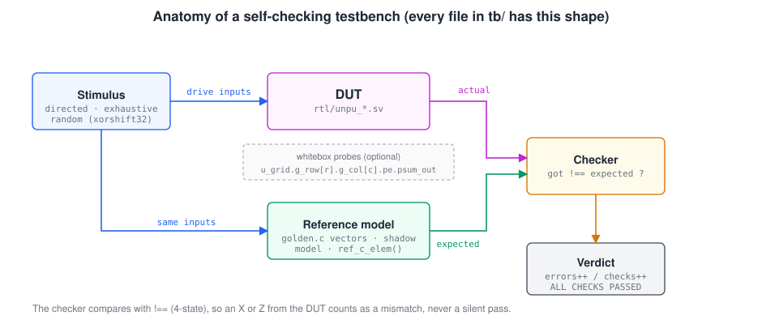

| Concept | What it means | Where you see it |
|---|---|---|
| **DUT** | Design Under Test, the RTL instance the testbench drives | `unpu_pe dut (...)`, `unpu_top dut (...)` |
| **Self-checking** | The TB computes the expected answer and compares it, so nobody reads waveforms to judge | Every TB: `if (got !== exp) errors++` |
| **Reference model** | An independent way to get the right answer | `golden.c` vectors, `ref_c_elem()`, shadow models |
| **Shadow model** | A software copy of a block's state, updated by the same rules each cycle | `unpu_csr_tb`, `unpu_pe_tb` adversarial phase |
| **Black-box vs white-box** | Check only ports, or also peek at internal signals | `top_tb` is black-box; `stall_tb` probes 44 internal registers |
| **Directed test** | A hand-picked input with a known answer | PE vectors 1–24, `cross_terms` |
| **Exhaustive test** | Every possible input, when the space is small | 256 × 256 × 2 modes on the PE |
| **CRV** | Constrained-random: random but legal inputs, fixed seed | 64 `crv_*` cases (M, N, K ∈ 1–4, both modes) |
| **Adversarial / biased random** | Random inputs pushed toward extremes | `biased_byte()` favouring `0x00/0x7F/0x80/0xFF` |
| **Back-pressure** | The memory refuses requests for random lengths of time | 0–5 and 50–100-cycle `dma_ready` stalls |
| **Reproducibility** | Same seed → same stimulus on any simulator | Own `xorshift32`, never `$random` |
| **4-state compare** | `!==` treats X and Z as mismatches | Every checker |
| **Mutation testing** | Break the RTL on purpose and confirm the tests fail | 13 mutants, all caught (section 7) |
| **Cross-simulator** | Same tests on a second simulator to expose simulator-dependent behaviour | Verilator vs Xcelium |

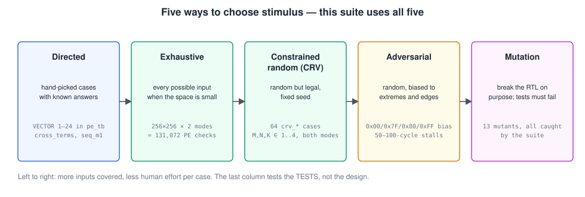

---

## 3. The golden model (`model/golden.c`)

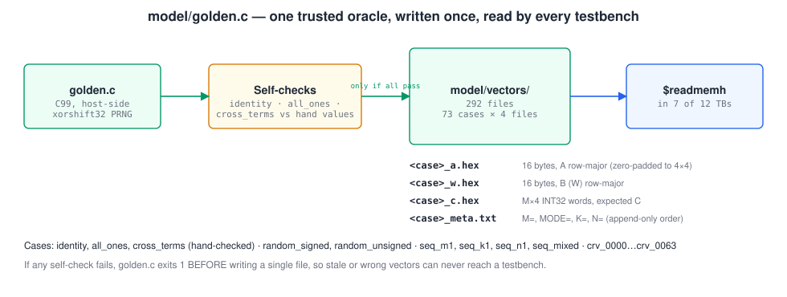

A plain C99 host program that is the **single source of truth** for arithmetic. Seven testbenches read its output with `$readmemh` instead of each re-deriving expected values.

**One MAC, matching the PE's two modes:**

```c
static int32_t mac_product(uint8_t a, uint8_t w, npu_mode_t mode) {
  if (mode == MODE_UNSIGNED)
    return (int32_t)((uint32_t)a * (uint32_t)w);
  int8_t as = (int8_t)a, ws = (int8_t)w;           /* two's-complement */
  return (int32_t)as * (int32_t)ws;
}

static void matmul(const uint8_t *A, int M, const uint8_t *W, int32_t *C, npu_mode_t mode) {
  for (int m = 0; m < M; m++)
    for (int j = 0; j < 4; j++) {
      int32_t acc = 0;
      for (int k = 0; k < 4; k++) acc += mac_product(A[m*4+k], W[k*4+j], mode);
      C[m*4+j] = acc;
    }
}
```

Smaller K or N is handled by zero-padding A and W to 4 × 4, so `matmul()` never needs to know the real sizes.

**Fail-fast self-checks.** Three cases have hand-computed answers. If any disagrees, the program exits **before writing a single file**, so a broken oracle can never feed the testbenches:

```c
/* identity: C must equal A */
if (C_identity[m*J + j] != (int32_t)A_identity[m*K + j]) { ...; return 1; }
/* cross_terms: every output is a sum of two distinct products, so a swapped
   row or column in the skew wiring changes the answer (identity would not) */
static const int32_t C_cross_expected[16] = { 7,10,5,8, 19,22,17,20, 31,34,29,32, 43,46,41,44 };
```

**Deterministic random cases.** A 3-line `xorshift32` replaces `rand()`, so the 64 CRV cases are bit-identical on every machine and compiler:

```c
static uint32_t xorshift32(uint32_t *s) { uint32_t x = *s; x ^= x << 13; x ^= x >> 17; x ^= x << 5; return *s = x; }

uint32_t state = 0x5eed0006u;                 /* CRV base seed */
for (idx = 0; idx < 64; idx++) {
  crv_m = xorshift32(&state) % 4 + 1;          /* each case draws its own shape */
  crv_k = xorshift32(&state) % 4 + 1;
  crv_n = xorshift32(&state) % 4 + 1;
  crv_mode = (xorshift32(&state) & 1) ? MODE_UNSIGNED : MODE_SIGNED;
  fill_crv_case(A_crv, W_crv, crv_m, crv_k, crv_n, &state);   /* zero-pads outside M×K, K×N */
  generate_case(name, A_crv, crv_m, W_crv, crv_mode, C_crv, crv_k, crv_n);
}
```

**Vector files** (all under `model/vectors/`, git-ignored, regenerate any time):

| Case(s) | Shape | Why it exists |
|---|---|---|
| `identity` | 4×4×4 | C must equal A; proves basic wiring |
| `all_ones` | 4×4×4 | every C = 4; proves all 16 PEs contribute |
| `cross_terms` | 4×4×4 | distinct values; catches row/column swaps that identity hides |
| `random_signed`, `random_unsigned` | 4×4×4 | full byte range in each mode |
| `seq_m1`, `seq_k1`, `seq_n1`, `seq_mixed` | M, K or N < 4 | padding and masking paths |
| `crv_0000` … `crv_0063` | random 1–4 each, random mode | broad CRV coverage |

> **Why the random cases matter:** `identity`, `all_ones` and even `cross_terms` all have a **symmetric** weight matrix (W = Wᵀ). A bug that loads the weights transposed gives the right answer on all three. Only the random and CRV cases, whose W is not symmetric, catch it.

Each case is `<case>_a.hex`, `<case>_w.hex` (bytes), `<case>_c.hex` (INT32 words), and `<case>_meta.txt` (`M=`, `MODE=`, `K=`, `N=`, in that fixed order, because older TBs parse only the first two lines).

---

## 4. Strategy: growing the DUT bottom-up

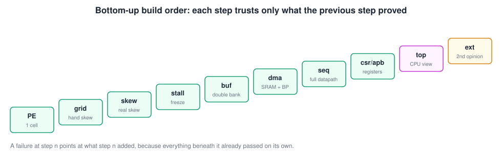

Each testbench adds one block to what the previous one proved. Blocks a testbench does not instantiate are replaced by the testbench itself: it forces weights, hand-skews inputs, or plays the sequencer. A failure therefore points at the newest block.

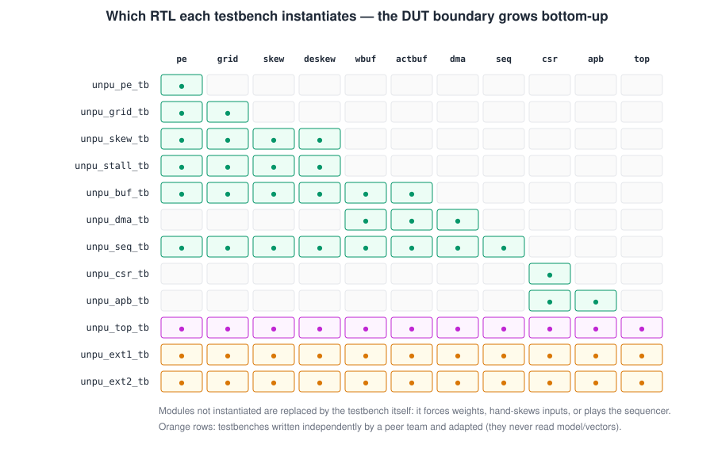

---

## 5. The testbenches, one by one

### 5.1 `unpu_pe_tb` — one processing element (934 lines)

**DUT:** `unpu_pe`. **Oracle:** an independent `expected_mac()` in SystemVerilog.

- 24 directed vectors: max/min values, `0xFF × 0xFF` in both modes, freeze with `array_en = 0`, reset mid-stream, back-to-back weight loads, accumulator near `0x7FFF_FFFF`.
- **Exhaustive:** every weight × every activation, both modes (131 072 checks). With only 2¹⁶ input pairs per mode, there is no reason to sample.
- Randomized weight-load timing and a long adversarial sequence with a cycle-by-cycle shadow model.

```systemverilog
for (w = 0; w < 256; w++) begin
  load_weight(w[7:0]);
  for (a = 0; a < 256; a++) begin
    act_in = a[7:0];  psum_in = 32'd0;
    step();
    exp_val = expected_mac(w[7:0], a[7:0], 32'd0, 1'b0);   // signed
    if (psum_out !== exp_val) begin errors++; $display("FAIL exhaustive-signed ..."); end
  end
end
```

### 5.2 `unpu_grid_tb` — the 4×4 array, skew done by hand (618 lines)

**DUT:** `unpu_grid`. The TB itself applies the input skew and checks the staggered outputs against the [timing contract](../rtl/README.md#43-unpu_skew-and-unpu_deskew--lining-up-the-wavefront), so the array is tested before any skew RTL exists.

```systemverilog
for (k = 0; k < 4; k++) begin            // A[m][k] enters row k at cycle m+k
  m = cyc - k;
  act_in[k] = (m >= 0 && m < case_M) ? A_case[m][k] : 8'h00;
end
step();
for (j = 0; j < 4; j++) begin            // C[m][j] leaves column j at cycle m+j+4
  m = cyc - j - 3;
  if (m >= 0 && m < case_M && psum_out[j] !== C_case[m][j]) errors++;
end
```

Also: all 64 CRV cases, a walking-one weight matrix (each PE alone), maximum-magnitude cases, and a freeze-point sweep.

### 5.3 `unpu_skew_tb` — skew → grid → de-skew (778 lines)

**DUT:** `unpu_skew` + `unpu_grid` + `unpu_deskew`. **No hand-skewing**: raw rows go in, and realigned rows must come out at `m + 7`. This proves the real skew RTL. Extra cases stress the **depth-0 lanes** (row 0, column 3), the classic one-flop-too-many bug.

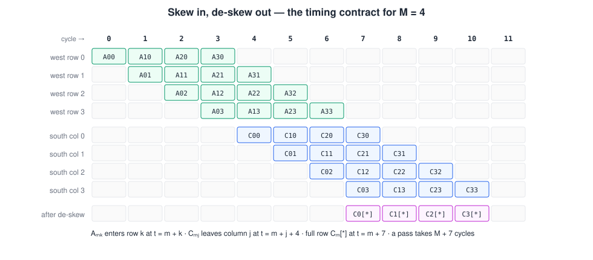

### 5.4 `unpu_stall_tb` — freezing mid-computation (789 lines)

**DUT:** the same chain. Drops `array_en` at random points for random lengths, then checks two things:

1. **Every** one of the 44 datapath registers holds its value during each frozen cycle (white-box).
2. The final C is **bit-identical** to an unstalled run.

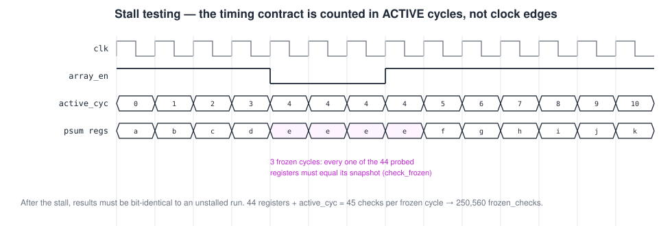

```systemverilog
// Bookkeeping uses active cycles: a stall pauses the contract's clock, not the real clock
if (u_skew.row3_q3 !== prev_row3_q3) begin errors++; $display("FAIL FREEZE ..."); end else frozen_checks++;
if (u_grid.g_row[2].g_col[1].pe.psum_out !== prev_pe_psum[2][1]) begin errors++; ... end else frozen_checks++;
```

### 5.5 `unpu_buf_tb` — double buffering (820 lines)

**DUT:** `unpu_wbuf` + `unpu_actbuf` + the compute chain; the TB plays the sequencer. The point is to prove a **background load into the inactive bank does not disturb a computation running on the active bank**. `fork ... join` runs both as truly parallel processes:

```systemverilog
fork
  run_compute_and_check("cross_terms (concurrent load in flight)", c_cur, 4, 4, 1'b0);
  begin
    repeat (2) step();                       // land inside the 11-cycle compute window
    drive_load_pair(a_tmp, w_tmp, 3, 2, 3);  // load seq_mixed into the other bank
  end
join
swap_both();                                 // only now may the new data take effect
```

A sequential load-then-compute test would pass even with a broken single-bank design. Also: an exhaustive K × N masking sweep, reverse-row weight settling, and rapid-fire load/swap.

### 5.6 `unpu_dma_tb` — the bus master (1 167 lines)

**DUT:** `unpu_dma` + both buffers, against the [SRAM model](#6-shared-infrastructure) with random back-pressure. Checks every beat's **exact address**, burst length for every shape, the 16-byte write stride, writes of only the real N columns, address wraparound near `0xFFFF_FFF0`, and 16-beat bursts under extreme stalls.

### 5.7 `unpu_seq_tb` — the whole datapath under the sequencer (1 310 lines)

**DUT:** `unpu_seq` + DMA + buffers + skew + grid + de-skew + SRAM model. Exercises the full job: fetch → swap → compute → write-back.

- Directed `cross_terms` and the four `seq_*` shapes, then all 64 CRV cases back to back **without reset**.
- Exhaustive illegal-dimension sweep (0, 5, 6, 7 on each of M, N, K) and recovery to a legal job.
- **Stray-start immunity:** `start` pulses at every point of a running job must be ignored.
- Extreme back-pressure (50–100 cycles per beat).

```systemverilog
start = 1; step(); start = 0;
for (cyc = 0; cyc < 4000; cyc++) begin      // bounded: a hang becomes a FAIL, not a stuck sim
  step();
  if (done) begin seen = 1; step(); break; end   // one settle cycle: DONE -> IDLE
end
if (!seen) begin errors++; $display("FAIL [%s]: done never observed", label); end
```

### 5.8 `unpu_csr_tb` — registers (656 lines)

**DUT:** `unpu_csr` alone; the TB drives `done_i` / `error_i` in place of the sequencer. There is no arithmetic, so the oracle is a **shadow model** that applies the RTL's own rules each cycle:

```systemverilog
new_src_a       = (wen_v && sel_v == 10'd0) ? wdata_v : sh_src_a;
new_ctrl_signed = (wen_v && sel_v == 10'd6) ? wdata_v[1] : sh_ctrl_signed;
new_start_pulse =  wen_v && (sel_v == 10'd6) && wdata_v[0];
new_status_done = sh_start_pulse ? 1'b0 : (done_v ? 1'b1 : sh_status_done);   // START clears first
...
check_eq1("mode_unsigned", mode_unsigned, ~sh_ctrl_signed);                    // polarity check
```

Also: extreme values in every register, a cross-talk matrix (writing one register must not touch another), and unmapped offsets (all of 8–31 plus random samples up to 1023) reading as zero with writes ignored.

### 5.9 `unpu_apb_tb` — the APB slave (796 lines)

**DUT:** `unpu_apb` + real `unpu_csr`. `pready == 1` is asserted **inside `step()`**, so it is checked on every cycle of the run. The key rule tested is that SETUP must never commit a write:

```systemverilog
task automatic apb_xact(input logic [9:0] sel, input logic [31:0] wdata, input bit is_write);
  paddr = {20'd0, sel, 2'b00}; pwdata = wdata; pwrite = is_write;
  psel = 1; penable = 0; step();   // SETUP  -- must not commit
  penable = 1;           step();   // ACCESS -- commits / prdata valid
  psel = 0; penable = 0;
endtask
```

Also: high address bits ignored, `penable` without `psel`, a very long SETUP phase, `pwrite` flipping between SETUP and ACCESS, and zero-gap back-to-back transfers.

### 5.10 `unpu_top_tb` — the CPU's view (1 068 lines)

**DUT:** the whole `unpu_top`, **black-box**: only the APB and DMA ports are touched, exactly as firmware would. 343 341 checks, the largest single testbench.

```systemverilog
apb_write(CSR_BASE + OFF_SRC_A, base_a);   apb_write(CSR_BASE + OFF_SRC_B, base_w);
apb_write(CSR_BASE + OFF_DEST_C, base_c);
apb_write(CSR_BASE + OFF_DIM_M, drv_m);    apb_write(CSR_BASE + OFF_DIM_N, drv_n);
apb_write(CSR_BASE + OFF_DIM_K, drv_k);
apb_write(CSR_BASE + OFF_NPU_CTRL, {30'd0, ctrl_signed_bit, 1'b1});     // START
for (poll_i = 0; poll_i < 4000; poll_i++) begin
  apb_read(CSR_BASE + OFF_NPU_STAT, rdata);
  if (rdata[0]) begin ok = 1; break; end                                // DONE
end
```

Also: register writes and status polls **during** a running job, wraparound addresses with real data, and maximum-speed configuration.

### 5.11 `unpu_ext1_tb` and `unpu_ext2_tb` — a second opinion (379 + 1 235 lines)

Written by a peer team for a different systolic architecture and **adapted** to this design. They never read `model/vectors`; each computes C from the operands in SRAM with its own model. If `golden.c` and our testbenches shared a misreading of the spec, these could disagree with both.

- `ext1`: one 4×4 case (A = B = 1…16), run in both modes. 34 checks.
- `ext2`: reset state, register map, invalid configs, extreme and signed corners, all 64 shapes × 2 modes, adjacent regions, reset mid-transfer, redundant START, a stuck SRAM for 1 000 cycles, 60 random rounds × 2 modes, and a **bus protocol checker**. 15 231 checks, 325 rounds.

```systemverilog
// dma_* must stay stable while a request waits (valid && !ready)
always @(posedge clk)
  if (prev_valid_pending &&
      (dma_addr !== prev_addr || dma_wdata !== prev_wdata || dma_wstrb !== prev_wstrb))
    begin $display("FAIL [PROTOCOL VIOLATION]: dma bus changed while valid&&!ready"); fail_count++; end
```

---

## 6. Shared infrastructure

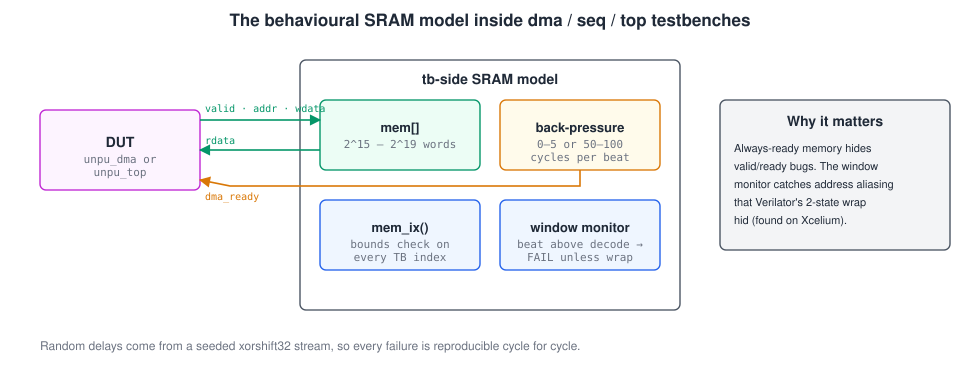

**`step()` with a settle delay.** Every TB advances the clock and waits 1 ns, so non-blocking assignments have settled before anything is checked:

```systemverilog
task automatic step;  @(posedge clk);  #1;  endtask
```

**Behavioural SRAM with back-pressure** (`dma`, `seq`, `top`): combinational read, a write on `valid & ready & wstrb == F`, and a random 0–5-cycle delay per beat drawn from a seeded `xorshift32`:

```systemverilog
assign dma_rdata = mem[dma_addr[MEM_ADDR_BITS+1:2]];
always_ff @(posedge clk)
  if (dma_valid && dma_ready && dma_wstrb == 4'hF) mem[dma_addr[MEM_ADDR_BITS+1:2]] <= dma_wdata;
```

**Window monitor and `mem_ix()`.** Any DMA beat above the modelled address range is a failure unless a test explicitly declares wraparound. Every testbench-side index is bounds-checked. Without these, an address bug can alias silently into the right word.

```systemverilog
always @(posedge clk)
  if (dma_valid && dma_ready && (dma_addr >> (MEM_ADDR_BITS + 2)) != 0 && !wrap_expected)
    begin errors++; $display("FAIL [mem window]: DMA beat at addr 0x%08h is outside ...", dma_addr); end
```

**Bounded waits.** Every "wait for done" is a `for` loop with a cap and a `seen` flag, never an open `while`. A hang becomes a counted FAIL with a message instead of a simulation that never ends.

**One final verdict line** per TB (`ALL CHECKS PASSED` or a TB-specific variant) plus a check count, which `run_xrun.sh` parses.

---

## 7. Results

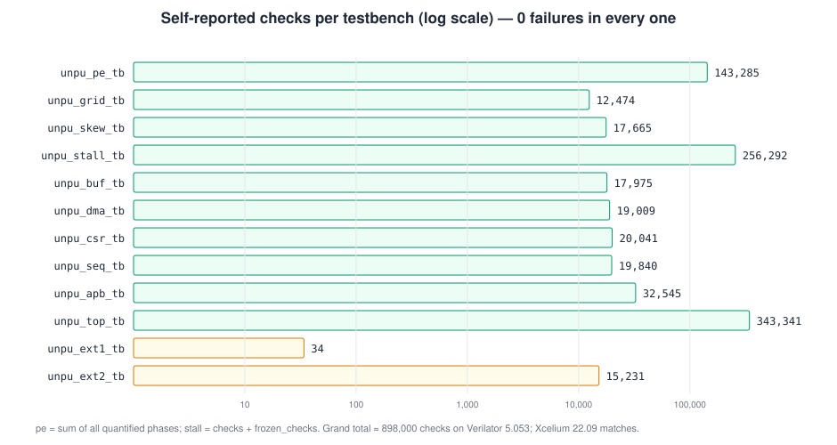

| Testbench | Checks | Verilator 5.053 | Xcelium 22.09 |
|---|---:|:---:|:---:|
| `unpu_pe_tb` | 143 285 (+24 directed vectors) | pass | pass |
| `unpu_grid_tb` | 12 474 | pass | pass |
| `unpu_skew_tb` | 17 665 | pass | pass |
| `unpu_stall_tb` | 5 732 + 250 560 frozen | pass | pass |
| `unpu_buf_tb` | 17 975 | pass | pass |
| `unpu_dma_tb` | 19 009 | pass | pass |
| `unpu_csr_tb` | 20 041 | pass | pass |
| `unpu_seq_tb` | 19 840 | pass | pass |
| `unpu_apb_tb` | 32 545 | pass | pass |
| `unpu_top_tb` | 343 341 | pass | pass |
| `unpu_ext1_tb` | 34 | pass | pass |
| `unpu_ext2_tb` | 15 231 (325 rounds) | pass | pass |

Counts are from `docs/freeze-report-v2.md` (and its addenda). The suite was also re-run with fresh random seeds at full scale, and `ext1`/`ext2` under randomized initial flop values (six seeds), all passing.

### Mutation testing: does the suite have teeth?


Thousands of passing checks prove nothing if the checks cannot fail. Each mutation below was applied alone, in a throwaway `git worktree`, and the whole suite was run:

| # | Mutation | Caught by (failures) |
|---|---|---|
| 1 | `unpu_seq`: COMPUTE exits one cycle early (`m_lat + 6` → `+ 5`) | `seq` 6 537, `top` 113 373, `ext1`, `ext2` |
| 2 | `unpu_pe`: signed/unsigned polarity inverted | `pe` 106 273, `grid`, `skew`, `stall`, `buf`, `seq`, `top`, `ext2` |
| 3 | `unpu_dma`: write stride 16 → 15 bytes | `dma` 1 774, `seq`, `top`, `ext1`, `ext2` |
| 4a–c | `unpu_dma`: address bit 15, 16 or 20 stuck at 0 | `dma`, `seq`, `top` |
| 5a–c | `unpu_dma`: address bit 30 or 21 stuck at 1 (always, or only on wraparound) | window monitor / exact-address checks |
| 6 | `unpu_deskew`: one register ignores `array_en` | `stall` (names the register), `skew` |
| 7a–c | TB SRAM shrunk to the old size | bounds and window checks |

All 13 mutants were caught. One gap is worth noting: `ext1` alone misses mutant 2, because its data (1…16) has the same value signed and unsigned.

---

## 8. Bugs verification found, and lessons

| Found by | Problem | Fix / lesson |
|---|---|---|
| Xcelium (first run) | Use-before-declaration in three TBs; Verilator allowed it | Declare before use; run a second simulator |
| Xcelium | TB SRAM too small: Verilator **silently wrapped** the index, so write and read aliased "correctly" | Bigger SRAM, `mem_ix()` bounds checks, window monitor |
| Xcelium | `$random(seed)` gives different streams on different simulators | Use the TB's own `xorshift32` everywhere |
| Random init (`ext1`) | Window monitor sampled power-up flops before reset | Gate monitors with `rst_n` |
| Verilator | An open-ended `while (job_done !== 1)` hung the scheduler | Bounded `for` loops with a `seen` flag |
| `seq_tb` | `start` issued while still in DONE is dropped and looks like a hang | Wait one settle cycle after `done` |
| Review of `golden.c` | `identity`, `all_ones` and `cross_terms` all have symmetric W, so a transposed weight load passes them | Keep non-symmetric random cases in every TB that loads weights |
| Mutation #2 vs `ext1` | Data identical in both modes cannot catch a polarity bug | Always include values ≥ `0x80` |

None of these were RTL bugs. The RTL has not changed since the APB revert.

---

## 9. What is not covered

- **Timing:** no gate-level timing or STA is part of this suite (that lives in `sta/` and `syn/`).
- **Formal:** no formal property checking or equivalence checking.
- **Code/functional coverage metrics:** the suite argues completeness by construction (exhaustive where small, CRV elsewhere) and by mutation testing, not by a coverage database.
- **Firmware co-simulation:** the RISC-V + C MNIST test from the course brief needs the full SoC and is outside this macro's testbenches.
- **Scan / BIST:** out of scope for this project.
